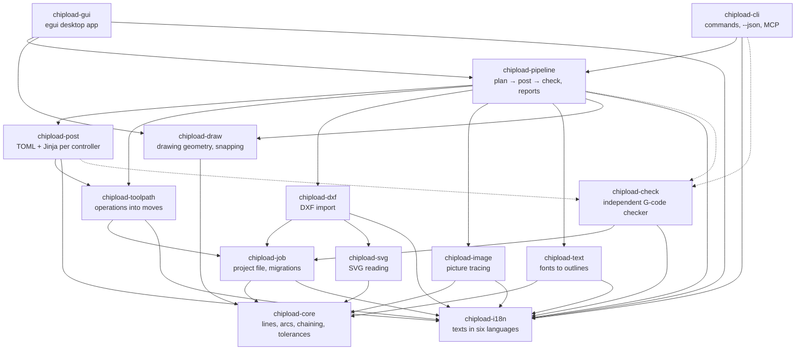

# Architecture

Chipload turns drawings, pictures and text into checked G-code for CNC routers and mills.
It is a Rust workspace of twelve crates in layers: geometry at the bottom, two thin front
ends on top, and an independent checker that every program must pass before it leaves.

This page is the overview. The rules in full are in `CLAUDE.md`, each feature's behaviour
in `docs/specs/`, and the reasons for each library and design in `docs/decisions/`.

## The layers

Each crate uses only crates below it, never above. `crates/chipload-cli/tests/architecture.rs`
checks this on the resolved dependency graph, so a wrong dependency fails CI.



| Layer | Crates |
|---|---|
| Front ends | `chipload-gui`, `chipload-cli` |
| Services | `chipload-pipeline` |
| Output | `chipload-post` |
| Generators | `chipload-toolpath`, `chipload-dxf`, `chipload-svg`, `chipload-image`, `chipload-text` |
| Drawing | `chipload-draw`: drawing geometry for the shapes drawn in Chipload (ADR 0023) |
| Model | `chipload-job` |
| Geometry | `chipload-core` |
| Beside the rest | `chipload-check`: uses only `core`, `job` and `i18n`; `chipload-i18n`: the app's texts, no workspace crate |

`chipload-check` reads the finished G-code text and checks it on its own terms. It shares no
code with the generator, so it can disagree with it.

## From drawing to G-code

The GUI's Generate button and the CLI's `run` both call one function,
`chipload_pipeline::run_job`. It returns either G-code that passed the check or a typed
error.

A project holds one or more **setups** (docs/specs/setups.md): boards clamped one after the
other, each with its stock and work zero. `run_job` plans the active setup only
(`Job::for_setup`: the other setups' parts are off, operation numbers unchanged), so one
program is always one board. `run_setups` runs every setup that is on, one `run_job` each,
and names the files `-S1…`, `-S2…` when there are several.

1. **Validate.** Check the project's values and resolve its post-processor, built in or
   copied into the project (`toolpath::plan::validate_job`, `pipeline::posts::job_post`).
2. **Load the drawings.** The drawings stored in the project become contours, each with its
   placement: move, turn, scale (`pipeline::load_drawing`, with `chipload-dxf`,
   `chipload-image`, `chipload-text`). DXF input is treated as hostile; anything ignored or
   repaired goes into the `ImportReport`.
3. **Plan.** Each part's operations select contours and become one machine-neutral
   `Program` in mm (`toolpath::plan::plan_job_cancellable`): profiles, pockets, V-carves,
   follow paths, holes, surfacing. Parts are cut one after the other with their copies, and
   moves are grouped by tool. Every offset is verified after it is built.
4. **Post.** The program is moved into work coordinates and rendered through the
   controller's template, in mm (G21) or inch (G20): one file per tool, or one file with
   tool changes (`pipeline::post_and_check`, `chipload-post`).
5. **Check.** Every file goes through `check::check_gcode` with the machine's limits and its
   tool's radius. If any check fails, no G-code is returned.
6. **Report.** The time estimate, notes and import report are added. The front ends draw
   the toolpath, the simulation and the setup sheet from the same result
   (`pipeline::estimate`, `report`, `sheet`, `simulate`).

## The crates

| Crate | Responsibility | Uses |
|---|---|---|
| `chipload-core` | Lines and arcs, chaining into contours, which contour is inside which, fitting arcs to points, every tolerance (`tolerances`). No I/O. | no workspace crate; cavalier_contours |
| `chipload-job` | The project file and everything else saved to disk: versioned loading with one migration per schema step, saving with a `.bak`, the tool library and machine profiles, settings, recovery notes. | core, i18n |
| `chipload-dxf` | DXF into shapes and contours: blocks expanded, splines and ellipses approximated, duplicates and zero-length removed, everything reported. SVGs too, read by `chipload-svg`, as drawing files of their own format. Also the way out: shapes written as a DXF (R12 layout, its own writer) and read back. | core, job, i18n, svg; dxf |
| `chipload-svg` | SVG into shapes of lines and arcs in mm: usvg resolves styles, `use`, transforms and units into paths; curves fitted with lines and arcs; layers from Inkscape layers or stroke colours; text, pictures and clips counted, not imported (ADR 0024). `chipload-dxf` makes its shapes a drawing file (docs/specs/svg-import.md). | core, i18n; usvg, flate2 |
| `chipload-image` | PNG, JPEG and BMP into black and white, then traced loops or centre lines, with arcs. | core, i18n; image |
| `chipload-text` | Text into closed outlines with arcs in the built-in fonts, or in a font file's bytes (the computer's fonts, found by the pipeline). | core, i18n; ttf-parser |
| `chipload-draw` | Drawing geometry on core's lines and arcs: where segments cross, the points the cursor snaps to (ends, intersections, centres, quadrants, middles, perpendicular, tangent, nearest); offsets of drawn shapes, and the other editing operations to come (docs/specs/drawing-editing.md). No I/O, no project model. | core; cavalier_contours |
| `chipload-toolpath` | Selection, offsets, profiles with tabs and ramps, pockets with rest machining, V-carving on the medial axis, follow paths, holes, surfacing, merging overlapping letters, job planning. | core, job, i18n; cavalier_contours, boostvoronoi |
| `chipload-post` | Post-processors as data: a TOML config and a Jinja template each for GRBL, LinuxCNC and Mach3, plus users' own. | job, toolpath, i18n, check; minijinja |
| `chipload-check` | Parses G-code and checks machine limits, arc endpoints against centre and radius, feeds, units, retracts, and rapids through stock. | core, job, i18n |
| `chipload-pipeline` | The services: run and plan, the report and setup sheet, time and chip-load estimates, the height-map simulation, messages in the display units, licence notices, the computer's fonts for texts (fontdb, not in the browser build; ADR 0027). | every library crate |
| `chipload-cli` | The `chipload` command: every feature, `--json` on every command, `get`/`set` by path, JSON schemas, an MCP server. | pipeline and below, i18n; clap |
| `chipload-i18n` | The app's texts in English, German, French, Spanish, Italian and Swedish: Fluent files compiled in, looked up by id; messages from the library crates as an id with typed arguments, shown in any language and units; the number rules for lengths and feeds (docs/specs/translations.md). No I/O. | no workspace crate; fluent-bundle |
| `chipload-gui` | The desktop app: ribbon, browser of parts and operations, canvas, forms, simulation playback. It builds a `Job` and calls the pipeline on a background thread. Its texts come from `chipload-i18n`. | pipeline and below, draw, i18n; eframe, rfd, sys-locale |

## Rules the code follows

Enforced by the architecture test:

1. `chipload-core` is headless and at the bottom: no I/O, no GUI, no other workspace crate.
2. Dependencies point down: front ends → pipeline → toolpath, post, dxf, job → core.
   Nothing depends on the GUI or the CLI.
3. `chipload-check` never depends, even indirectly, on toolpath, post, dxf or pipeline.
4. Only `chipload-gui` uses GUI libraries (egui, eframe, winit, rfd).

Kept by review:

5. Every feature works from the CLI before it gets a UI.
6. The UI is thin: no geometry or toolpath logic in `chipload-gui`.
7. Post-processors are data, never code written per machine.
8. Library crates don't print, don't call the network and don't `unwrap`. Errors are typed
   per crate.

## Principles

- **Safety before features.** The program drives a real machine. Offsets are verified
  rather than trusted, a panic inside a geometry library becomes an error, arcs are checked
  radius by radius, and nothing unchecked leaves `run_job`.
- **Millimetres inside.** Geometry and toolpaths are always in mm, angles in radians, Y up.
  Units are converted only at the edges: DXF import, display and G-code output.
- **Same input, same bytes.** A project always gives byte-identical G-code: no hash-map
  order, no timestamps, explicit number formats. Golden files in `tests/corpus/expected/`
  catch any change.
- **Files that last.** Every saved format has a `schema_version`. Old projects migrate one
  step at a time, and a frozen sample of every version (`tests/corpus/jobs/v<N>/`) must
  still give the same G-code. A newer or broken file is refused, never guessed at.
- **Libraries that run in a browser.** All library crates compile to WebAssembly
  (`docs/specs/web.md`). Only the front ends read and write files.
- **Written down first.** A new operation or algorithm starts as a spec in `docs/specs/`,
  and a library choice gets an ADR in `docs/decisions/`. The user guide changes in the same
  commit as the feature.
- **Clean room.** Every line is Chipload's own: nothing is copied, ported or paraphrased
  from other CAM programs or toolpath libraries (`CONTRIBUTING.md`).

## Finding your way

Start with the spec for the area you're changing, then its tests. Most changes touch one
generator crate and the pipeline, and are tried from the CLI first.

```
cargo test --workspace                                    # everything
cargo test -p chipload-cli --test golden                  # G-code regression
cargo run -p chipload-cli -- run part.chipload -o out.nc  # one project, end to end
```
