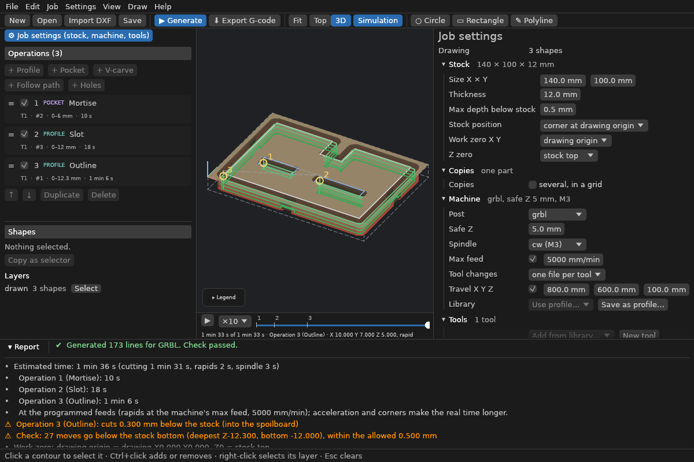
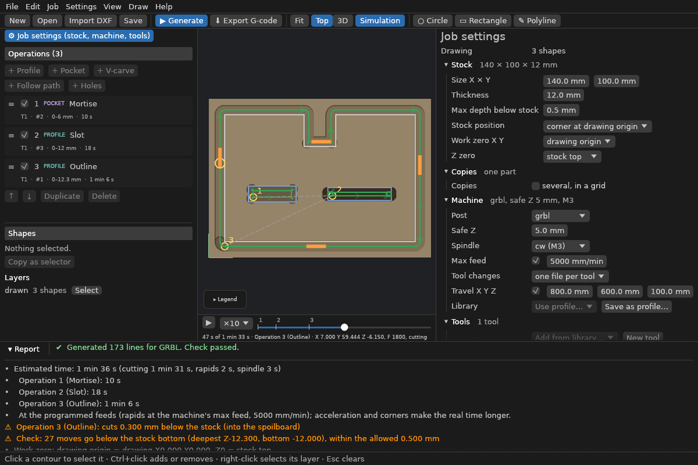

# 3D view, simulation and playback

## 3D view

**3D** (toolbar) shows the toolpath at its real depths.
- **Turn:** left-drag.
- **Pan:** right-drag.
- **Zoom:** the scroll wheel.
- **Back to top view:** *View > Top view* (T).
- **Shallow cuts:** *View > Z scale in 3D* stretches depth, for cuts too shallow to see.

## Simulation

*View > Show simulation* (or **Simulation** on the toolbar) cuts the stock with every move
of the program and shows the result.
- **Top view:** a shaded picture.
- **3D:** a surface you can turn.
- **Tool shapes:** each tool's real shape is used: a flat endmill, a V-bit's cone with its
  tip, and a drill's 118° point.
- **When:** it runs in the background after each generation.

Use it to see what the toolpath really leaves:
- material in corners;
- a missing pass;
- a cut into the wrong place;
- the floor of a V-carve.

The report gives the volume removed and the deepest cut.

On the command line, `chipload simulate part.chipload` prints the same numbers and writes a
shaded top view (`part-sim.png`). `--after N` stops after the first N moves.

## Playback

Under the canvas, a **slider** runs through the program by time, like a 3D printer's
preview:
- **Dragging:** the moves done so far are drawn, the rest faint, and the tool is shown where
  it is.
- **With the simulation on:** the stock is shown as cut up to that point.
- **Marks** on the slider show where each operation starts and where the tool changes.
- **The readout** shows the time so far and in all, the operation and copy, the tool's X,
  Y and Z, and the feed.

**Keys:**
- ← / → one move;
- Shift + ← / → to the next mark;
- Home / End the start or the end.

**▶** plays it at ×1, ×10 or ×100 the estimated speed.

