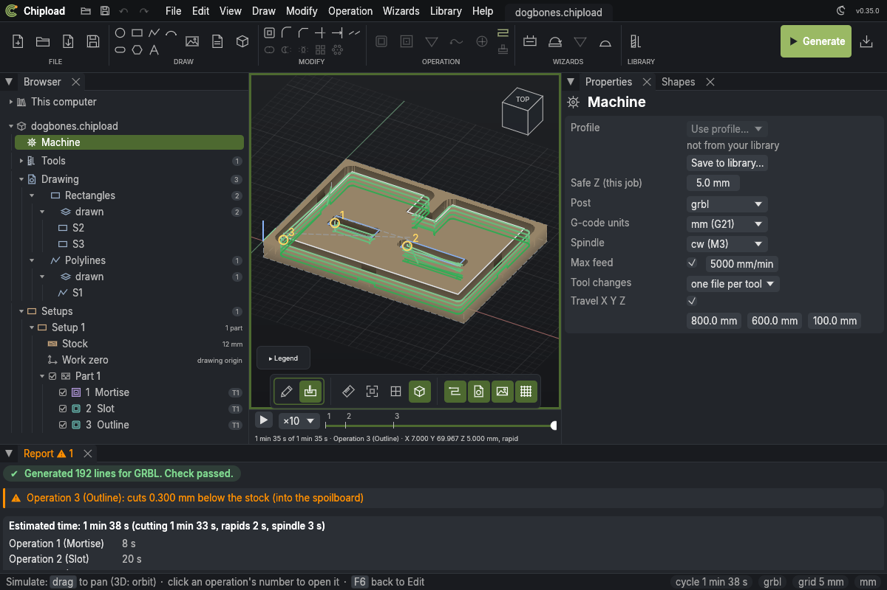
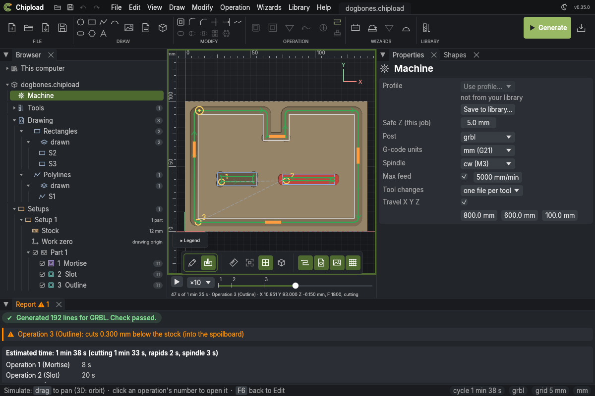

# 3D view, simulation and playback

## 3D view

**3D**, on the canvas's [navigation bar](../window.md#the-canvas), shows the toolpath at
its real depths.
- **Turn:** left-drag.
- **Pan:** right-drag.
- **Zoom:** the scroll wheel.
- **Back to top view:** **Top** on the navigation bar, *View > Top view* or T.
- **Straight at a side:** click a face of the cube in the canvas's top right corner (TOP,
  FRONT, RIGHT, …).
- **Shallow cuts:** *View > Z scale in 3D* stretches depth, for cuts too shallow to see.

## Simulation

The simulation cuts the stock with every move of the program and shows the result, in
**Simulate** mode: the **Edit | Simulate** switch on the canvas's navigation bar, *View >
Simulate* or F6, and **Edit** or F6 to go back ([Edit and Simulate](../window.md#the-canvas)).
- **Top view:** a shaded picture.
- **3D:** the board as a solid you can turn: holes cut through are open, and the board
  stands on its sides.
- **Tool shapes:** each tool's real shape is used: a flat endmill, a V-bit's cone with its
  tip, and a drill's 118° point.
- **When:** in the background, when you enter Simulate and after each new toolpath while
  you're in it; in Edit nothing is simulated. Until it's done, the canvas says *Updating
  the simulation…* and still shows the stock as the last toolpath cut it. Back in Simulate
  without changes, the last simulation shows at once. With no toolpath yet, entering
  Simulate makes one.
- **What makes a new toolpath:** a change that can change the cut. Drawing a shape that no
  operation selects doesn't, unless the board fits the drawing and grows with it, or the
  shape lies off the stock.
- **Without the toolpath:** *View > Show toolpath* (also **Toolpath** on the navigation bar
  and a checkbox on the canvas legend)
  hides the toolpath's lines, plunges and tabs. During playback, the tool still shows where
  it is.
- **The stock alone:** turn off **Drawing** on the navigation bar (or *View > Show
  drawing*) as well, and only the simulated stock is left.

Use it to see what the toolpath really leaves:
- material in corners;
- a missing pass;
- a cut into the wrong place;
- the floor of a V-carve.

The report gives the volume removed and the deepest cut.

On the command line, `chipload simulate part.chipload` prints the same numbers and writes a
shaded top view (`part-sim.png`). `--after N` stops after the first N moves.

**Both sides of a board.** A [back side](../concepts/setups.md#the-back-side-experimental)
is simulated on its front's result: the front is cut first, then the back from below, so you
see the finished part. The report adds the area cut through and, where neither side alone
goes through but the two together do, *The two sides meet* with its area: a plain note, as
that can be meant. `chipload simulate part.chipload --setup 2 --face back` draws the back
face, the board as it lies turned over; `--face front` the front. A back setup's picture
shows its own face by default.

In the window, Simulate mode has **Turn over** on the navigation bar for a board with two
sides: the board shown back face up, as it lies for its back's setup, in the top view and
in 3D, the toolpath and shapes turned with it. Making the back setup active turns it over;
making the front active turns it back. In Edit mode the board is always seen from the
front, where you draw.

## Playback

Under the canvas, a **slider** runs through the program by time, like a 3D printer's
preview:
- **Dragging:** the moves done so far are drawn, the rest faint, and the tool is shown where
  it is.
- **With the simulation on:** the stock is shown as cut up to that point, also part of the
  way along a long straight move.
- **Marks** on the slider show where each operation starts and where the tool changes.
- **The readout** shows the time so far and in all, the operation and copy, the tool's X,
  Y and Z, and the feed.

**Keys:**
- ← / → one move;
- Shift + ← / → to the next mark;
- Home / End the start or the end.

**▶** plays it at ×1, ×10 or ×100 the estimated speed.

