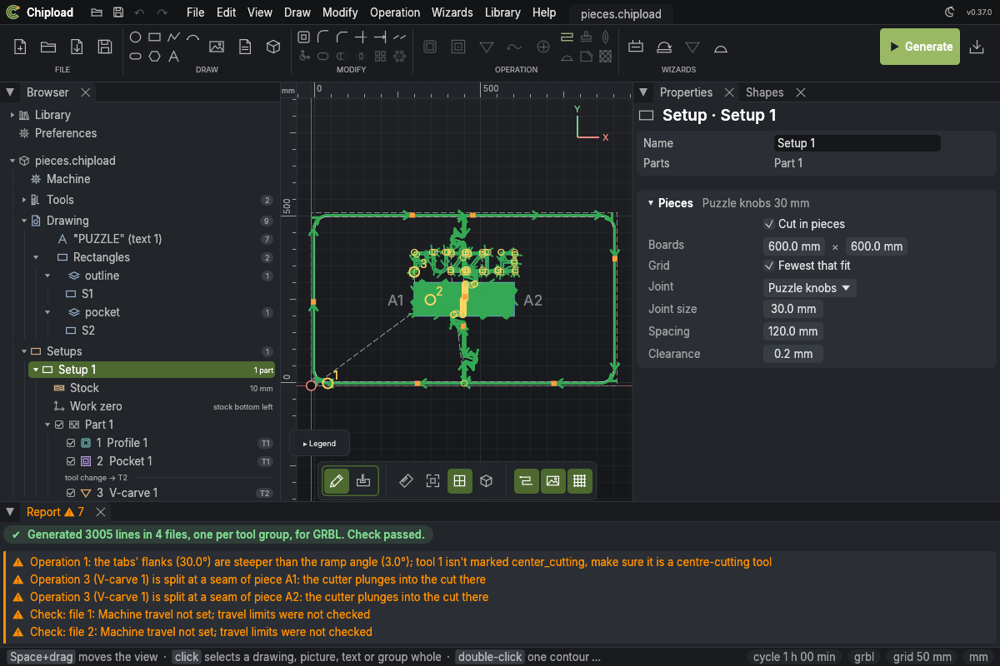

# Pieces

A shape larger than your boards, such as a round table top, a big sign or a map, can be cut
as a puzzle. Seams split it into **pieces** that each fit a board, and puzzle knobs or
fingers along the seams lock the pieces together. Each piece is cut as a program of its own,
from a board of its own, and the pockets, V-carving and text carry on across the seams. Once
the pieces are cut, you glue them together.



## Turning it on

Draw the whole thing at full size, with its operations, as for one board. The pieces are the
outline that the setup's **outside profiles** cut out, so the setup needs at least one.

Then open the setup (its row in the Browser) and tick **Cut in pieces** in its **Pieces**
section:

- **Boards:** the size of the boards you have. Each piece, with its joints and a margin,
  fits on one. It starts at the machine's travel when the machine profile has one.
- **Grid:** *Fewest that fit* lets Chipload pick the fewest columns and rows. Untick it to
  give the columns and rows yourself; each seam can then be moved from its even place, to
  keep it out of a letter or a narrow spot.
- **Joint:** *Puzzle knobs* (round heads on narrower necks, alternating in and out along a
  seam) or *Fingers* (square teeth with rounded corners).
- **Joint size:** a knob's head across (30 mm unless changed) or a finger's length (15 mm).
- **Spacing:** from knob to knob (120 mm), or a finger and a gap (60 mm).
- **Clearance:** the room left between two pieces at a seam, for glue (0.2 mm). Each piece
  gives half of it.

The view shows each piece's outline dashed, with its name inside it: A1, A2 and so on, the
row's letter counted from the bottom and the column's number from the left. Generating
shows the pieces' programs put together on the whole board, and the simulation shows the
puzzle as it will be once it's glued.

## How the pieces are cut

- Each piece's outline is cut by the outside profiles, joints and all. The seam is one curve
  shared by the two pieces, so they fit each other.
- Everything else (pockets, V-carving, text, flutes, holes) is generated once for the whole
  board. Each piece then cuts its share of it, a little past the seam, into what is waste on
  its own board. A V-carved word across a seam keeps its full depth on both sides and lines
  up when the pieces are glued.
- Where a cut is split at a seam, the cutter comes down there at the plunge feed. In a pocket
  or a profile that is at most one step down. A V-carve or another cut that moves up and down
  can be deeper there, and the report says so.
- Joints stay clear of the outline's edge, and of the corners where two seams cross.
- A joint must suit the cut-out tool. Its tightest curve must be at least the tool's radius
  plus the clearance: for knobs, a fifth of the joint size. If it isn't, Chipload names the
  smallest joint size that works.

## Boards, zeros and files

Each piece is cut from a board fitted round it, with the setup's margin (10 mm when the
setup's board has a fixed size). The setup's work zero is used on each piece's board: a
corner of the board becomes the same corner of each piece's board. A zero that falls off a
piece's board, such as the drawing's origin, becomes that board's bottom-left corner, and the
report says so.

Exporting writes a program for each piece, named after it: `table-A1.nc`, `table-A2.nc`, or
`table-A1-1-T1.nc` and so on with a file per tool. The setup sheet starts with a map of the
pieces as they go together. Then, for each piece, it gives the board, the zero, the programs
and a reminder to write the piece's name on its back before you unclamp it. It ends with how
to glue them.

## On the command line

```sh
chipload setup pieces table.chipload --board 600x400            # knobs, the defaults
chipload setup pieces table.chipload --joint fingers --grid 3x2 # fingers, 3 × 2 pieces
chipload setup pieces table.chipload --shift-x 2=15             # move the 2nd seam 15 mm
chipload run table.chipload -o table.nc                         # a program per piece
chipload run table.chipload -o table.nc --piece A2              # only piece A2
chipload simulate table.chipload -o table.png                   # the pieces put together
chipload simulate table.chipload -o a2.png --piece A2           # one piece on its board
chipload dxf export table.chipload -o pieces.dxf --pieces       # the pieces, a layer each
chipload setup pieces table.chipload --off                      # one board again
```

Without `--board`, the boards are the size of the machine's travel. `--size`, `--spacing`
and `--clearance` set the joints. `chipload plan` still plans a setup in pieces as one board.

## Not yet

- Laying several pieces out on one board: each piece gets a board of its own.
- Seams along a line you draw, and joints other than knobs and fingers.
- Pieces together with a back side (two-sided work) or with copies.
