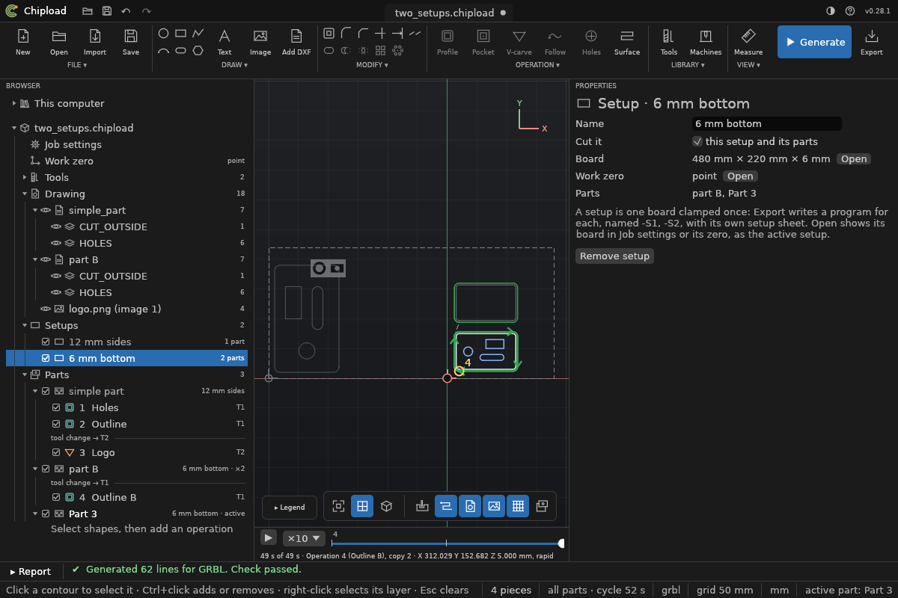

# Setups

A **setup** is one board clamped once on the machine: its stock, its work zero, and the
parts cut from it. Most projects have one and never need to think about it. A project needs
more when its parts come from more than one board, or from one board clamped more than once:

- a box with sides from 12 mm plywood and a bottom from 6 mm;
- a big sheet whose parts lie far apart, each group with its own zero nearby.

Each setup is a **program of its own**, run on its own, with its own setup sheet: the
operator clamps the board, sets the zero and runs that program, then the next. Chipload never
puts two boards in one program, because re-measuring in the middle of a program is where
crashes come from.

## What a setup holds

- **Its board:** size, thickness, fit, Z zero, max overcut and material, as
  [Stock and work zero](stock.md) describes. A board that fits the drawing fits **its own
  parts**: the shapes its operations cut.
- **Its work zero.**
- **Its parts**, each with its operations and copies ([Parts](../operations/parts.md)).

The drawing, the machine, the tools and the materials are the project's, shared by every
setup: you draw all parts in one drawing, a layer per part, and each setup's board is placed
around its own.

## Running

With one setup the files are named as always (`part.nc`, `part-1-T1.nc`, …). With more, each
file names its setup first: `part-S1.nc`, `part-S2-1-T1.nc`, and each setup's sheet beside
them (`part-S2-sheet.html`). `run` writes every setup that is on; `--setup N` only one.
`plan`, `sheet` and `simulate` work on the active setup, or the one `--setup N` names.

## In the window

A project with one setup looks as it always did. Right-click **Parts** in the Browser and
choose **Add a setup** for another board: it starts like the active one, with a part of its
own, and both become active.

With two or more, the Browser shows **Setups**. Click one to make it the **active setup**:
it is shown in full colour, generated, simulated and exported, while the other boards and
their shapes are ghosts, faint and out of the way. Its form has its name, its on/off tick,
and *Open* buttons to its board (Job settings) and its work zero. Each part's row says which
setup it is in; right-click a part for **Move to setup ▸**.

**Export G-code** writes the active setup's program, named `-S1`, `-S2` as `run` names them,
with its own sheet. Make the next setup active and export it too. A setup whose parts still
have operations can't be removed: move them or delete them first.



## On the command line

```sh
chipload setup add box.chipload --name "6 mm bottom" --thickness 6   # with a part of its own
chipload setup part box.chipload 2 --to 2        # part 2 is cut from setup 2's board
chipload setup list box.chipload
chipload setup set box.chipload 2 --name "Bottom" --off
chipload setup activate box.chipload 1
chipload setup remove box.chipload 2 --with-parts
chipload set box.chipload setups.1.stock.thickness=6     # a board's values, by path
chipload run box.chipload -o box.nc --setup 2
```

In paths, a setup's board is `setups.N.stock…` and its zero `setups.N.work_zero`, counting
from 0. The older `stock.…` and `machine.work_zero` still work and mean the active setup's.
