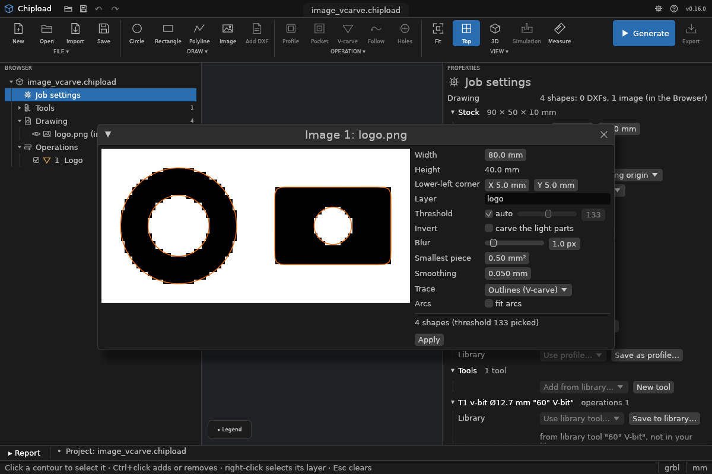

# Images

A picture, such as a logo, a scanned sketch or lettering, can be traced into shapes and then
[V-carved](../operations/vcarve.md). Chipload turns it black and white, traces the edges
between black and white, and puts the outlines on a layer of their own.

A picture of **strokes**, such as handwriting, a signature or line art, can instead be traced
into the strokes' [centre lines](#centre-lines) and cut with a
[follow path](../operations/path.md).

**Black is what gets carved:** for a V-carve, black is the inside of the shapes. A light logo
on a dark background needs **invert**.

PNG, JPEG and BMP pictures work, up to 20 MB and 20 megapixels. The picture is stored in the
project, so its settings can be changed later.

## Size and place

You give the picture's **width in mm**; its height follows from the picture. Chipload
doesn't use the picture's DPI, which is often missing or wrong. Its lower-left corner goes at
X, Y (0, 0 unless you say).

## Black and white

| Setting | Default | |
|---|---|---|
| **Threshold** | auto | grey values (0 black, 255 white) below it are black, 1 to 254. *Auto* picks the value that best separates the picture's dark and light parts (Otsu's method) and says which it picked. |
| **Invert** | off | carve the light parts instead |
| **Blur** | 1 px | smooths ragged edges and scan or JPEG noise before the threshold, 0 to 10 px |
| **Smallest piece** | 0.5 mm² | black or white specks smaller than this are dropped, 0 to 100 mm² |
| **Smoothing** | 0.05 mm | how far a traced edge may be straightened away from the picture's edge, 0.01 to 1 mm |
| **Trace** | outlines | *outlines* round the black parts, for a V-carve; or *centre lines* of black strokes, for a follow path |
| **Arcs** | on | fit arcs as well as lines (below) |

## The traced shapes

- **Smooth edges:** the edge is traced where the blurred grey crosses the threshold, between
  pixel centres, so there are no pixel steps.
- **Always valid:** the outlines are always closed and never cross. A white part inside a
  black one is a hole, as in a pocket.
- **Picture border:** black that reaches the picture's edge is closed along it, with a note:
  usually a background that wants **invert**.
- **Too many shapes:** a picture that traces into more than 5000 shapes (a photo, noise) is
  refused. Blur it more, raise the smallest piece or change the threshold.
- **Arcs:** with *arcs* on, the edges are fitted with arcs as well as lines, still within the
  smoothing: a traced logo becomes a few dozen pieces instead of hundreds of short lines. A
  profile, pocket or follow path of them is then cut with G2/G3 arcs: a smaller program, and
  smoother motion, since a controller slows down at every short line. A V-carve gains little:
  its moves are lines anyway. An outline whose arcs would come too near another one is kept
  as lines, and the report says so.
- **Not editable:** the shapes can't be edited in Chipload.

**Changing a setting traces the picture again** and replaces its shapes, which get new ids.
So select the image's **layer** in the operation, never the shapes one by one: Chipload refuses
an operation that selects traced shapes by id.

The drawing's [placement](placement.md) moves only the DXF's shapes, never a traced picture;
a picture has its own X, Y and width.

## Centre lines

With **Trace: centre lines**, each black stroke becomes a path along its middle: open, or
closed for a ring like an O. A [follow path](../operations/path.md) cuts each stroke in one
pass at the depth you choose, as wide as the bit, whatever the pen did. Select the image's
layer and **+ Follow path**.

- **Junctions:** where strokes meet (a T, a Y), their paths end at the same point.
- **Ends:** a path stops half a stroke's width short of a round stroke end, at the middle of
  its curve, so a bit as wide as the stroke reaches the end. Small side branches from a
  rough edge or a square corner are tidied away.
- **Stroke width:** the report gives the strokes' width ("Strokes 2.9 to 3.2 mm wide"), to
  pick a bit by.
- **Dots** (the point of an i, a full stop) are too small for a centre line. They are left
  out and counted in the report.
- **For strokes only:** a filled area's centre line is a branching skeleton. That is correct,
  but rarely what you want; a wide range in the stroke widths shows it.
- **Only a follow path:** a profile, pocket or V-carve of a centre-line layer is refused,
  with a hint to use a follow path or trace the image as outlines.

## In the app

**File > Import image…** picks a picture and opens its window. A project is made first if
none is open. Without a file dialog (see [Install](../install.md)), *File > Import image from
path…* takes the picture's path instead.
- **Left:** the picture as black and white, with the traced outlines over it in orange,
  updated as you change the settings.
- **Right:** the settings, the width, the corner and the layer, and what was traced (with the
  threshold *auto* picked).
- **Import:** puts the shapes into the project and selects their layer, so **+ V-carve** carves
  them (or, for centre lines, **+ Follow path** cuts them). It is one undo step.



**Afterwards:**
- **Change it:** in the [Drawing panel](several.md#the-drawing-panel), the image's row has
  **⋯ > Edit…**, which opens the same window (its button says **Apply**), and **Remove**,
  which removes the picture and its shapes.
- **See it:** *View > Show images* shows the pictures faintly under the drawing, for
  comparing the traced shapes with the picture.
- **Operations:** clicking traced shapes on the canvas and adding an operation selects their
  layer, not the shapes.

## On the command line

```
chipload image add part.chipload logo.png --width 120 --at 10,10 --threshold auto
chipload image add part.chipload signature.png --width 80 --trace centre-line
chipload image set part.chipload 1 --threshold 140 --blur 2 --invert true --arcs false
chipload image list part.chipload
chipload image preview part.chipload 1 -o bw.png
chipload image remove part.chipload 1
```

- **`image add`:** the layer is the file's name unless `--layer` says otherwise. It reports
  how many shapes were traced, the threshold, the specks dropped, and whether black touches
  the border; for centre lines also the stroke widths and the dots left out.
- **`image preview`:** writes the black-and-white picture exactly as it is traced.
- **`chipload set`:** also reaches the settings (`drawing.images.0.threshold=140`). The image
  is then traced again, as with `image set`, also for `--set` on a single run.

## In the file

`drawing.images` in the [project file](../reference/project-file.md#image): `id`, `file`,
`sha256`, `data` (the picture, base64), `layer`, `x`, `y`, `width`, `threshold` (a number
or `"auto"`), `invert`, `blur`, `min_area`, `smoothing`, `trace` (`"outline"` or
`"centre_line"`), `arcs`. The traced shapes are `path` shapes with `"image": id`. Images in
projects from Chipload 0.15 open as outlines without arcs, exactly as they were traced.
