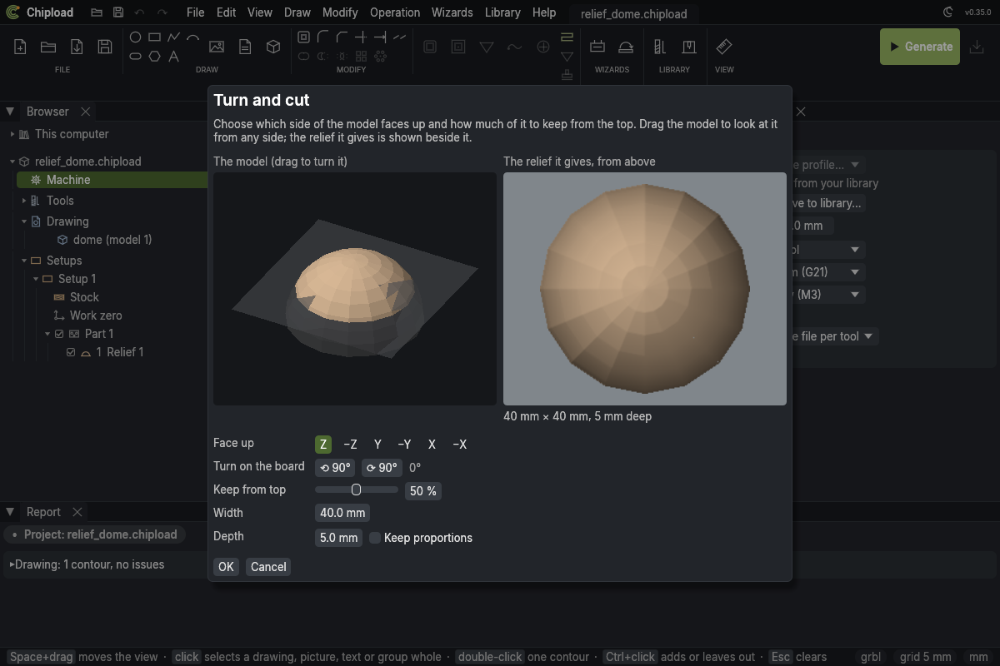
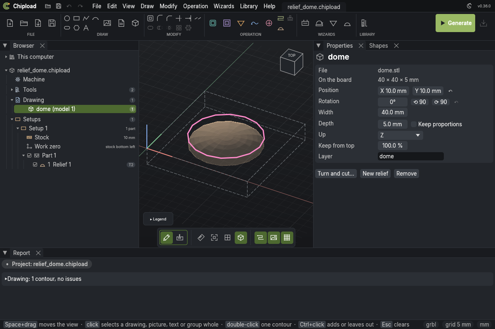

# 3D models

A 3D model in an STL file can be carved into the board from the top as a **relief**: a
sign with raised, rounded letters, a rosette, a coin, a landscape. The model lies on the
board like a picture, seen from above, and is carved in three axes; nothing under an
overhang is reached. (Design: `docs/specs/stl-relief.md`.)


## A relief in one step

**Relief…** (the ribbon's WIZARDS group, or *Wizards > Relief…*) makes a whole relief, one
question at a time, each needing only the ones before it:

1. **Model:** an STL file, or a model already in the project.
2. **Turn and cut:** which side faces up, quarter turns, and how much to keep from the top
   (as in [Turn and cut](#turn-and-cut)).
3. **Size and place:** width and depth, centred on the board or at a point; the board's
   thickness, which the depth must stay within.
4. **Round it:** nothing; the background lowered by a pocket round the model, the model
   standing in it as an island (a margin, and rounded corners if you like); or the relief
   cut out through the board with tabs.
5. **Tools:** the ball nose that finishes it; an end mill to rough it first, ticked when the
   relief is deeper than the ball nose is wide; the end mill for the background or cut-out,
   by default the roughing one, so one tool does both.
6. **Check and make:** what will be made, in cutting order, with the tools and tool changes.

From step 3 on, a picture of the board beside the questions shows the relief where it will
lie, and the pocket or cut-out round it. **Make** adds it all as one undo step, in a part of
its own: the model, the background pocket, the relief with its roughing pass, the cut-out.
Afterwards they are ordinary shapes and operations.

From the command line, the same answers in the same order:

```sh
chipload relief add sign.chipload rose.stl --keep 50% --width 120 --depth 6 \
    --around background --margin 10 --tool 2 --rough-tool 1
```

`--model ID` uses a model already in the project; `--up`, `--rotate`, `--at X,Y`,
`--corner`, `--allowance` and `--end-mill` answer the rest. The tools are project tool
numbers.

## Adding a model

In the window: **3D model** in the ribbon's DRAW group, **File > Add 3D model…**, *Add 3D
model…* on the Browser's Drawing folder, or drop an STL file on the window. *File > Import…*
and *File > Open…* take an STL too, as a new project. The model starts half the board wide at the drawing's
origin, as deep as its own proportion gives but no deeper than half the board (then
*Keep proportions* is off), and its properties open.

From the command line:

```sh
chipload model add sign.chipload rose.stl --width 120 --depth 6 --at 20,20
```

- **The file:** binary or text STL. It is kept inside the project, as pictures are, so the
  project stays one file; a model over 20 MB says that the project gets as large.
- **`--width`:** its width on the board; the height follows. Without it, the model keeps its
  own size.
- **`--depth`:** how deep the relief goes, from the model's top at the stock top to its
  lowest point. Reliefs are usually flatter than the model: a 14 mm tall model carved 4 mm
  deep. Without it, the depth is in proportion to the width, and follows the width when it
  changes.
- **`--at X,Y`:** where the lower-left corner of its footprint goes; **`--rotate`** turns
  it about its centre, any angle.
- **`--up`:** which of the model's axes points up: `z` (the default), `y`, `x`, or one of
  them reversed (`-z` …). Many models are drawn with Y up.
- **`--units inch`:** STL files carry no unit. The size on import is read in mm, or in inches
  with this; since the model is placed by its width, it matters only for that first size.
- **`--keep`:** how much of the model to keep, from its top: `0.5` or `50%` keeps the top
  half and cuts away the rest, its back (see below). By default all of it.
- **`--layer`:** the layer for its outline; by default the file's name.

The report says how many triangles it has, any without an area that were left out, and
how many open edges its surface has: a gap in a model lets the tool fall through to the
relief's floor.

## Turn and cut

When a model is added, **Turn and cut** opens (and later *Turn and cut…* in its
properties): the model in 3D on the left, the relief it gives seen from above on the right,
both redrawn as you change them.



- **Drag the model** to look at it from any side.
- **Face up:** which of the model's sides faces up: Z, Y, X or one of them reversed.
- **Turn on the board:** a quarter turn either way.
- **Keep from top:** the cut level (below). The part kept is coloured, the part cut away
  grey, and the plate is the level.
- **Width** and **Depth**, as in the properties; the size it gives is under the relief.

**OK** changes the model as one undo step and draws its outline again; **Cancel** leaves it
as it was. The views are drawn from a light copy of the model (at most 50 000 triangles),
so a large file turns smoothly; the outline, the toolpath and the G-code always come from
the full model.

## Keeping the front: the cut level

A model made to be seen from every side (a figure, a head, an animal) would be carved from
its top all the way down to its lowest point: most of the depth goes into its far side,
which the tool can't reach anyway, and the side you see comes out flat. **Keep from top**
in its properties (`model set sign.chipload 1 --keep 50%`) cuts it level at that share of
its height and keeps the part above: the front half of a head keeps its whole outline,
and its depth and width are now that half's. So set the cut level first, then the depth
the board allows; a depth you typed stays when the cut level changes. Where the cut goes
through the model, the relief is cut to its floor.

## Its outline

The model's footprint seen from above becomes a closed shape on its layer, drawn again
whenever the model is moved or changed. Select it for a profile to cut the relief out of
the board, or for a pocket that clears round it: click the outline, Ctrl+click a shape round
it, then **Pocket**, and the outline stays an island in the pocket. The outline keeps its
shape ids when it is drawn again, so the pocket still finds it after the model moves.

## Changing and removing

In the window the model is a row of the Browser's Drawing folder; a click selects its
outline and shows its **properties**: the file, its size on the board, *Position* (the
lower-left corner before the turn), *Rotation*, *Width*, *Depth* with *Keep proportions*,
*Up*, *Keep from top* and *Layer*. Each change draws the outline again, as one undo step. Selected on the
canvas it has a picture's **handles**: drag the middle to move it, the round handle to
turn it, a corner to size it. In the **3D view** it shows faintly as its surface, until a
simulation is shown. *Remove* (in its properties or on its row) takes the model and its
outline; a relief of it stays, with a problem, until it carves another model.



```sh
chipload model set sign.chipload 1 --rotate 15 --depth 4
chipload model set sign.chipload 1 --proportional     # the depth follows the width again
chipload model list sign.chipload                     # file, up axis, place and size
chipload model remove sign.chipload 1                 # the model and its outline
```

`chipload set sign.chipload drawing.models.0.width=100` works as well, and draws the outline
again.

## Carving it: the Relief operation

In the window: **New relief** in the model's properties or on its row, or *Operation >
New Relief*, which carves the selected model, or the first. A relief is made in the
active part, with a ball nose when the project has one.

From the command line:

```sh
chipload tool add "Ball 3" --type ballnose --diameter 3     # then `tool use` it in the project
chipload op add sign.chipload relief --model 1             # a relief of model 1, within its outline
chipload set sign.chipload operations.0.stepover=0.1 operations.0.angle=0.785
```

A **Relief** carves the model in parallel lines across its area, each point as low as the
tool can go without cutting into the model: the tool is lowered onto the model's triangles
until it first touches one. A ball nose gives the smoothest finish; a tapered ball nose
reaches finer detail; an end mill or a V-bit works too, with their own marks.

- **Area:** with `--model`, the model's outline: the tool's centre stays inside it, so
  round the model a groove the tool's width is left, and the board beyond is untouched.
  Clear the background with a pocket, or select other closed shapes for the area.
- **`stepover`:** the distance between lines as a share of the tool; smaller is smoother and
  slower. With a ball nose a new relief takes the widest stepover that leaves ridges of
  0.02 mm between its lines on flat ground, which wood doesn't show: 20 % for a 2 mm ball,
  16 % for 1/8", 12 % for 6 mm. The relief's form shows the ridges for the stepover you set.
  Finer only takes longer: a 2 mm ball at 10 % leaves ridges of 0.005 mm and takes about
  three times as long. Other tools start at 10 %.
- **`angle`:** the lines' direction in radians from X (0 by default). Lines at an angle to the
  model's long edges leave fewer marks.
- **`zigzag`:** back and forth (true, the default), or every line the same way, lifting
  between them.
- **`start_depth`:** how far below the stock top the model's top lies. Its lowest point is
  the start depth plus the model's depth, which the checker holds within the stock.

In the project file a relief reads:

```json
{ "type": "relief", "name": "Relief 1", "enabled": true, "part": 1, "material": null,
  "model": 1, "select": { "model": 1, "shapes": null, "layer": null }, "tool": 2,
  "start_depth": 0.0, "end_depth": 5.0, "stepover": 0.1, "angle": 0.0, "zigzag": true,
  "feed": 1500.0, "plunge_feed": 500.0 }
```

`model` names the model it carves; `end_depth` is made again from the model's depth
whenever the project is read or changed.

Along each line the tool stays within 0.01 mm of where the model needs it: more points are
added where the surface bends. When the program is made, the path is checked against the
model once more by a simpler test of its own; if anything would cut into the model, nothing
is made and the report says where.

## Roughing first

A finishing ball nose is small, and a relief can be deeper than it should cut in one go
(the plan warns when the relief is deeper than the tool is wide). A **roughing pass** takes
most of the material first with a larger tool. In the window: *Add roughing pass ▸* on the
relief's row in the Browser, with your project's and library's end mills and plain ball
noses; the pass shows under the relief, with its own properties. From the command line:

```sh
chipload op add-roughing sign.chipload --op 1 --tool 1 --allowance 0.5mm
chipload set sign.chipload operations.0.roughing.step_down=2.5
chipload op remove-roughing sign.chipload --op 1
```

- **The tool:** an end mill or a plain ball nose (not a V-bit or a tapered ball nose). Its
  feeds, step down and stepover come from the tool library's cutting data, or else from the
  relief, half the tool's diameter and 0.4.
- **Levels:** it goes down one `step_down` at a time from the stock top to the relief's
  lowest point, along the relief's lines (`stepover` apart, at the relief's angle), and
  cuts only where material is left above each level.
- **`allowance`:** what it leaves on the model for the finish, 0.5 mm by default, all
  round, not only above: on steep sides too.
- **Never wider than the finish:** its area is the relief's, shrunk so its edge stays
  where the finishing tool reaches. The finish takes the narrow ring left inside the
  outline itself.

It is cut just before the relief, as pass *Operation 1.1 (Relief 1, roughing)*, with its
own tool; the program is checked to keep the allowance off the model. In the project file
it is the relief's `roughing`:

```json
"roughing": { "tool": 1, "feed": 1500.0, "plunge_feed": 500.0, "step_down": 3.0,
  "stepover": 0.4, "allowance": 0.5, "enabled": true }
```

