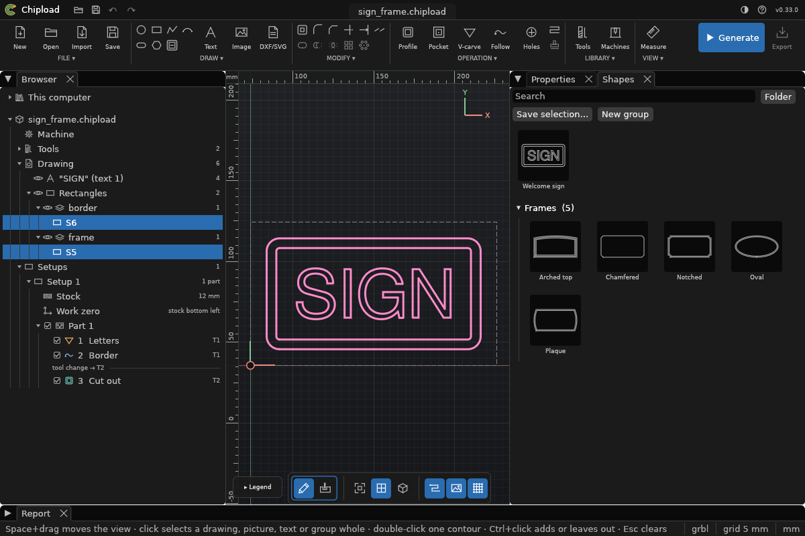

# The shape library

Shapes you use again and again, such as a frame you like, a house-number plate or a logo
with its border, can be kept in your **shape library** and put into any project. An entry
holds drawn shapes and texts; a text stays a text, so a saved sign can get new words.
(Design: `docs/specs/shape-library.md`.)



## In the window

The right panel has two tabs, **Properties** and **Shapes**. *Shapes* is the library: a
search field, then the entries as small pictures with their names, the ones in no group
first and each group under a header that folds.

- **Insert:** drag an entry onto the canvas. Its outline follows the pointer, snapped as a
  drawn point is, and where you let go the middle of its box lands. Or double-click it: it
  goes in the middle of the view. Either way the new shapes are selected, as one undo step.
  An entry of more than one shape or text comes in as a [group](groups.md) named after it,
  so one click selects it again later, to V-carve it for example.
  **Esc** while dragging lets go of it.
- **Save:** select shapes and texts, then drag a drawn shape of the selection onto the
  *Shapes* tab (onto its name when *Properties* is shown, or onto a group to save there),
  or click **Save selection…**, or right-click on the canvas: *Save to shape library…*. A
  name field opens, with the text's words or the layer's name in it; **Enter** saves. A
  name that is taken asks before it is replaced.
- **Right-click an entry:** *Insert in the middle of the view*, *Insert round the
  selection* (scaled to fit round what is selected, with the frame tool's margin),
  *Rename…*, *Move to* a group, *Delete…*, *Show in folder*.
- **Groups:** *New group*; drag an entry onto a group to move it there (or to the top for
  none). Right-click a group's header to rename it, delete it (only when empty) or show
  its folder.
- The tab stays open while you select shapes on the canvas. Clicking something in the
  Browser, or starting a tool with values (*Frame…*, *Array…*, a text), shows *Properties*
  again.

## Where it is kept

The library is a folder, `shapes` in your settings folder (`chipload shape library path`
says where). Each entry is one file, `NAME.chipload-shapes`, so an entry is backed up,
shared or deleted like any file. **Groups** are folders in it: `shapes/Signs/` is the group
*Signs*.

DXF and SVG files you copy into the folder are in the library too, inserted as an import
would read them (a DXF needs its units set). Imported shapes saved to the library become
drawn shapes; the link to their file isn't kept. A text whose font isn't on the computer it
is inserted on keeps its letters, as in [Text](text.md).

## On the command line

```sh
chipload shape save sign.chipload 5 6 --texts 1 --name "Signs/Welcome"   # shapes S5, S6 and text 1
chipload shape library list                                # the entries, by group (also just `shape library`)
chipload shape insert part.chipload "Signs/Welcome" --at 150,80
chipload shape insert part.chipload "Signs/Welcome" --around 3,4 --margin 10   # scaled round S3, S4
chipload shape insert part.chipload "Signs/Welcome" --width 300 --layer sign
chipload shape library rename "Signs/Welcome" "Signs/Hello"   # another group moves it
chipload shape library move "Signs/Hello" Doors             # "" for no group
chipload shape library remove "Doors/Hello"
chipload shape library group add Doors
chipload shape library group rename Doors "Front doors"
chipload shape library group remove "Front doors"           # only an empty one
chipload shape library path                                # the folder
```

- **save:** the shapes and texts given; a letter of a text saves the whole text. An entry
  of the same name is replaced only with `--replace`, and kept as `.bak`.
- **insert:** new shapes and texts with new ids, the middle of the entry's box at `--at`
  (the stock's middle without it), at the size it was saved, or scaled: `--width`,
  `--height`, `--scale`, or `--around` shapes with a `--margin` round their box. Shapes
  keep the layers they were saved on, or all go on `--layer`.
- **remove** moves the file to the folder's `.deleted`, where it can be taken back. A
  group is removed only when it is empty.
- **list** names an entry that can't be read and why; it is never changed.
