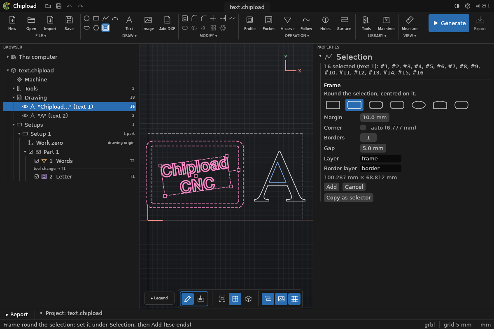
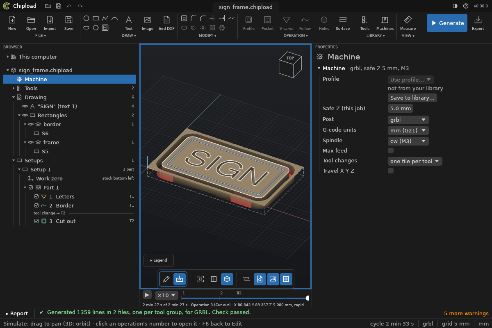

# Signs and frames

An engraved sign is a few words with a frame round them, cut out of a board. **Draw >
Frame…** draws the frame for you: round the text you have written, centred on it, with
border lines inside it, or to a size as a blank. (Design: `docs/specs/shape-library.md`.)



## A frame round a text

1. Write the text ([Text](text.md)) and leave it selected, or select any shapes: the frame
   goes round all of them.
2. **Frame**: the small button after the shape tools in the ribbon's *DRAW* group (a
   rounded frame with a line inside), or *DRAW ▾ > Frame…*. Its values open under
   *Selection*, and the frame shows on the canvas as you change them.
3. Pick a frame from the row of pictures, set the values, and click **Add**. The frame is
   added as one undo step, and its shapes are selected.

Clicking a shape while the tool is open makes it what the frame goes round (Ctrl+click
adds one); a click on empty space, or on the previewed frame, changes nothing. **Esc** or
*Cancel* ends the tool. The tool keeps your values until you close Chipload.

The frames:

| Frame | Its corner size is |
|---|---|
| **Rectangle** | (sharp corners) |
| **Rounded** | the corners' radius |
| **Notched** | the radius of the quarter circles cut into each corner |
| **Chamfered** | how far each corner is cut off at 45°, along each side |
| **Oval** | (an ellipse touching the four sides) |
| **Arched top** | how far the top arc rises above the top corners |
| **Plaque** | how far the short sides bulge out |

The values:
- **Margin:** from the box round what is selected to the **innermost** line, so the words
  sit evenly inside the border nearest them (10 mm by default). The frame is centred on that
  box and made just large enough: an oval grows in proportion, an arched top grows taller,
  a plaque grows along its long side. Its size shows under the values.
- **Corner:** the corner size (above). Unticked, it is a tenth of the frame's shorter side,
  shown greyed; tick it to set your own. One too large for the frame is refused, with the
  largest that fits.
- **Borders:** 0 to 3 lines inside the outline, each **Gap** further in (5 mm by default).
  They follow the outline's shape: a notched frame's borders are notched too.
- **Layer**, **Border layer:** the outline goes on `frame`, the borders on `border`, so that
  each can be cut by its own operation.

A frame is ordinary drawn shapes: a rounded or plain rectangle, a circle for a round oval,
otherwise a polyline of lines and arcs. Change it like any drawn shape, or draw it again:
delete it, change the text, and *Draw > Frame…* again with the same values.

## A frame to a size

With nothing selected, *Draw > Frame…* asks for the outline's **Width** and **Height**
instead of the margin, and the frame is centred on the stock: a blank for a sign, or a
plaque to write on afterwards.

## Cutting the sign

A sign is usually three operations, in this order:
1. a **[V-carve](../operations/vcarve.md)** on the text's layer, with a V-bit;
2. a **[Follow path](../operations/path.md)** on the `border` layer with the same V-bit: a
   groove along each border line, as wide as the V-bit is at that depth. (A V-carve of a
   border would carve the whole area inside it.);
3. a **[Profile](../operations/profile.md)** outside the `frame` layer with an end mill, to
   cut the sign out, with tabs.



The stock can sit round the drawing, sticking out equally on every side
([Stock and work zero](../concepts/stock.md)), so the board needs to be only as large as the
sign.

## From the command line

```
chipload text add sign.chipload "SIGN" --height 30 --at 150,80 --anchor center
chipload frame add sign.chipload --kind rounded --around-text 1 --borders 1 --corner 8 --margin 12
chipload frame add blank.chipload --kind oval --width 300 --height 150 --borders 2
chipload frame kinds
```

`--around` takes shape ids, `--around-text` text ids (`chipload text list`); without
either, `--width` and `--height` give the outline's size and `--at` its centre (the stock's
centre by default). The new shapes' ids are printed, the outline's first; `--json` gives
them with the frame's size and corner.
