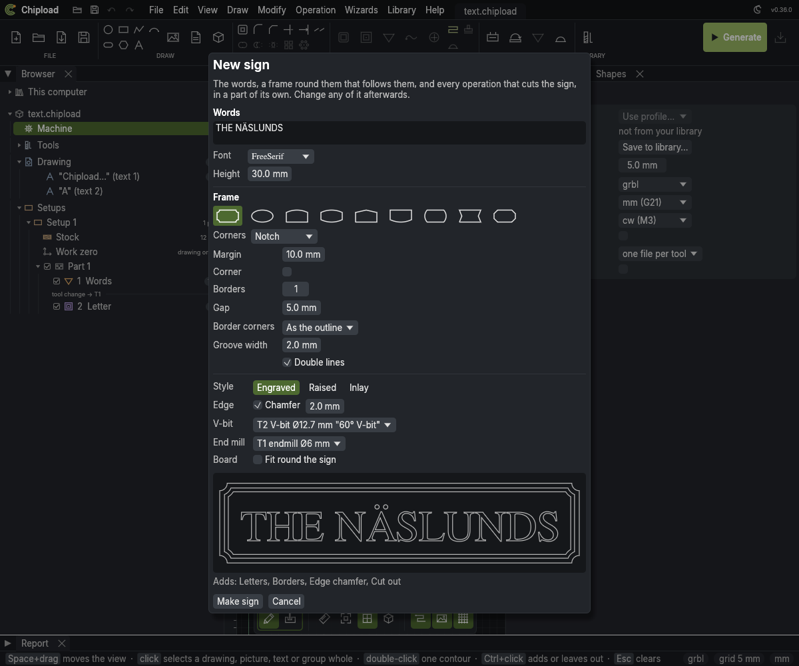
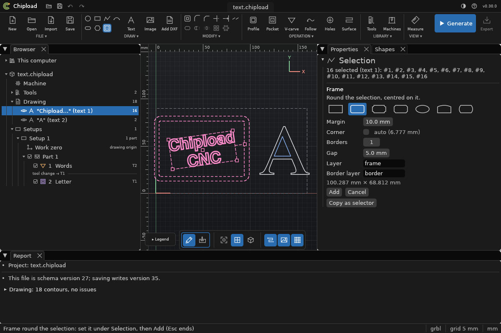
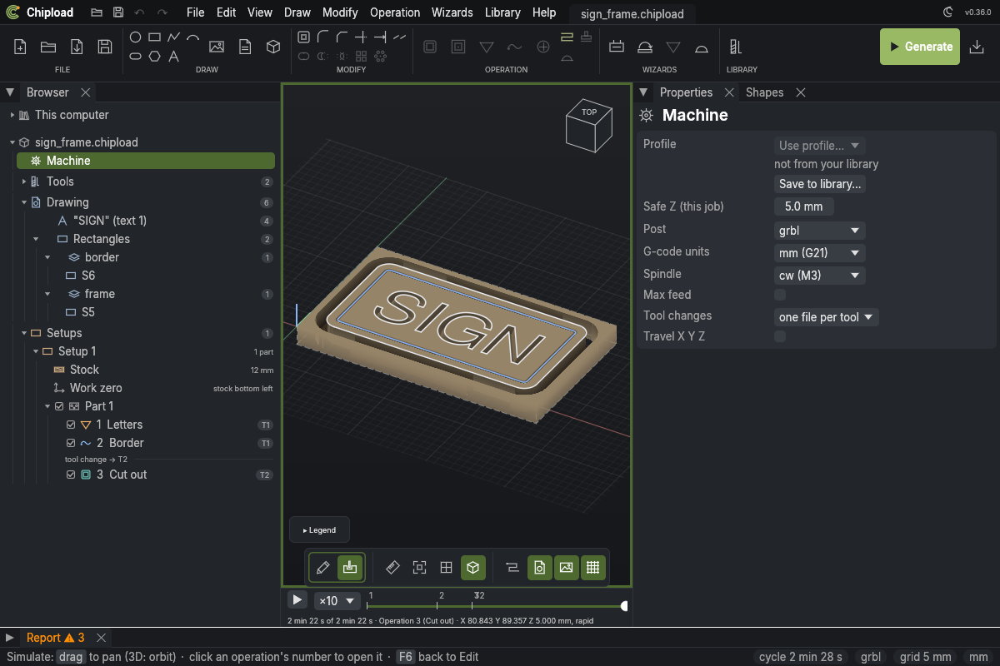

# Signs and frames

An engraved sign is a few words with a frame round them, cut out of a board. **New sign…**
(below) makes the whole sign, its operations too. **Draw > Frame…** only draws a frame: round
the text or shapes you have selected, centred on them, with border lines inside it, or to a
size as a blank, for a frame you cut with operations of your own. A sign you will make again can be kept in the
[shape library](shape-library.md). (Design: `docs/specs/shape-library.md`.)

## A sign in one step

**New sign…** (**Sign** in the ribbon's *WIZARDS* group, or *WIZARDS ▾ > New sign…*) makes a whole sign: the words, a frame round them, and every operation that
cuts it, in a part of its own named after the words (a new project's empty part becomes
it). The dialog draws the sign as it will be and lists the operations it adds. (Design:
`docs/specs/sign-maker.md`.)



- **Words**, **Font**, **Height**: the text, centred on the board. The font list is the
  text tool's: your recently used fonts first (the last one picked is chosen), then the
  built-in fonts and your computer's ([Text](text.md)). With shapes selected
  when you open it (a traced picture, a text, drawn shapes or a DXF's), the sign goes
  **round the selection** instead: those shapes are carved with the V-bit (an operation
  named *Carving*) and the frame follows them, a picture traced again too. *Write words
  instead* goes back to new words. A raised sign round a picture's or a DXF's shapes can't
  be made yet (its background pocket needs them grouped with the frame, and a group takes
  only drawn shapes and texts).
- **Frame**: as for *Frame…* below: the kind, margin, corner, borders and their groove
  width. The frame follows the words afterwards.
- **Style**:
  - *Engraved*: the letters V-carved;
  - *Raised*: the background inside the innermost border cut down round the letters with
    the end mill (**Background depth**, 3 mm by default), the letters and the border left
    standing; it needs a border. Inside corners round the letters keep the end mill's
    radius;
  - *Inlay*: the letters as a [V-carve inlay](../operations/vcarve.md#inlays), the plug in a
    board of its own.
- **Edge**: a **Chamfer** of that width round the outline, cut with the V-bit centred on the
  outline before the sign is cut out (the other half of the groove is in the waste).
- **V-bit**, **End mill**: the project's tools, then under *From your library:* your tool
  library's (marked **+**). A library tool is copied into the project when you click *Make
  sign*, not before. A project without such a tool starts on the library's. The V-bit
  carves the letters and the grooves, the end mill cuts the sign out (and clears a raised
  background).
- **Board**: *Fit round the sign* (on in an empty project) fits the stock round the drawing
  with the margin, at the thickness.

It adds, in cutting order: *Letters* (or *Background*, or the inlay's pocket), *Borders*
(a follow path on the border lines as deep as the groove width needs), *Edge chamfer*,
and *Cut out* (a profile outside the outline, through, with tabs). Feeds come from the
tools' cutting data. The words and the frame are one group: a click selects the sign, a drag
moves it. All of it is one undo step, and every part of it is ordinary shapes and
operations afterwards.



## A frame round a text

1. Write the text ([Text](text.md)) and leave it selected, or select any shapes, a traced
   [picture](images.md) for instance: the frame goes round all of them.
2. Right-click the selection and choose **Frame round the selection…**, or *DRAW ▾ >
   Frame…* (the way to a frame to a size, with nothing selected). Its values open under
   *Selection*, and the frame shows on the canvas as you change them.
3. Pick a frame from the row of pictures, set the values, and click **Add**. The frame is
   added as one undo step, and its shapes are selected.

Clicking a shape while the tool is open makes it what the frame goes round (Ctrl+click
adds one); a click on empty space, or on the previewed frame, changes nothing. **Esc** or
*Cancel* ends the tool. The tool keeps your values until you close Chipload.

The frames:

| Frame | Its corner size is |
|---|---|
| **Rectangle** | depends on its **Corners** (below) |
| **Oval** | (an ellipse touching the four sides) |
| **Arched top** | how far the top arc rises above the top corners |
| **Arched top and bottom** | how far each arc rises beyond the corners |
| **Gable** | how far the pointed top rises above the top corners |
| **Shield** | how far below the straight sides the point is; from half the width down, the sides curve into a point, shallower the bottom is one arc |
| **Plaque** | how far the short sides bulge out |
| **Banner** | how deep the V cut into each short end is (forked ends) |
| **Octagon** | (the corners cut off at 45°, the cut sides as long as the shorter sides) |

A rectangle's **Corners**:

| Corners | Its corner size is |
|---|---|
| **Sharp** | (none) |
| **Round** | the corners' radius |
| **Notch** | the radius of the quarter circles cut into each corner |
| **Chamfer** | how far each corner is cut off at 45°, along each side |
| **Step** | the side of the square cut out of each corner (at most a third of the shorter side) |

The values:
- **Margin:** from the box round what is selected to the **innermost** line, so the words
  sit evenly inside the border nearest them (10 mm by default). The frame is centred on that
  box and made just large enough: an oval grows in proportion, an arched top grows taller,
  a plaque grows along its long side. Its size shows under the values.
- **Corner:** the corner size (above). Unticked, it is a tenth of the frame's shorter side,
  shown greyed; tick it to set your own. One too large for the frame is refused, with the
  largest that fits.
- **Borders:** 0 to 3 lines inside the outline, each **Gap** further in (5 mm by default).
  They follow the outline's shape: a notched frame's borders are notched too.
- **Border corners** (a rectangle with borders): the borders' own corners, at the same
  gap, such as a round sign with a notched line inside. *As the outline* follows its shape.
- **Groove width:** how wide a border's groove will be at the surface: the V-bit's width at
  the depth it cuts. The margin is then measured to the inner edge of the innermost groove,
  so the words keep their distance from the cut, not from the line. 0 (the default)
  measures to the line.
- **Double lines:** each border two grooves, twice the groove width apart, which leaves a
  ridge as wide as a groove between them. It needs the groove width. The gap is then from
  one border's inner line to the next border.
- **Layer**, **Border layer:** the outline goes on `frame`, the borders on `border`, so that
  each can be cut by its own operation.

A frame is ordinary drawn shapes: a rounded or plain rectangle, a circle for a round oval,
otherwise a polyline of lines and arcs. Operations cut it like any other shape.

## The frame follows its text

A frame remembers what it goes round. Change the words, the font or the height of the text,
or move it, and the frame is drawn again round it, with its borders, in the same undo step.
Its shapes keep their ids, so the operations that cut them go on cutting them. A frame round
a picture follows it when it is traced again, at another size or place; one round other
shapes follows them when they move. A frame round only some of a text's letters or a
picture's shapes keeps those shapes by id, and lets go when they are made again.

Select the frame (its outline or a border) and its values show under *Selection*, in a
**Frame** card: the kind, margin, corner, borders and gap. Change them there and the frame is
drawn again. A frame drawn to a size shows its width and height instead, and follows
nothing.

The frame lets go, and becomes plain shapes that follow nothing, when:
- you edit one of its shapes by hand: move it alone, drag a corner, change its values in its
  own form (moving the frame *with* its text keeps it following);
- one of its shapes is deleted, or everything it went round is;
- **Detach** in its card, on purpose.

A note on the status bar says so each time. Undo brings the frame back as it was.

An older Chipload refuses to open a project with a frame that follows something, and says
why; detach the frame first to open the project there.

## A frame to a size

With nothing selected, *Draw > Frame…* asks for the outline's **Width** and **Height**
instead of the margin, and the frame is centred on the stock: a blank for a sign, or a
plaque to write on afterwards.

## Cutting the sign

A sign is usually three operations, in this order:
1. a **[V-carve](../operations/vcarve.md)** on the text's layer, with a V-bit;
2. a **[Follow path](../operations/path.md)** on the `border` layer with the same V-bit: a
   groove along each border line, as wide as the V-bit is at that depth. Set its **Groove
   width** to the frame's, and its end depth follows. (A V-carve of a border would carve
   the whole area inside it.);
3. a **[Profile](../operations/profile.md)** outside the `frame` layer with an end mill, to
   cut the sign out, with tabs.



The stock can sit round the drawing, sticking out equally on every side
([Stock and work zero](../concepts/stock.md)), so the board needs to be only as large as the
sign.

## From the command line

```
chipload text add sign.chipload "SIGN" --height 30 --at 150,80 --anchor center
chipload frame add sign.chipload --kind rounded --around-text 1 --borders 1 --corner 8 --margin 12
chipload frame add blank.chipload --kind oval --width 300 --height 150 --borders 2
chipload frame add sign.chipload --corners notch --around-text 1 --borders 1 --double --border-width 2
chipload frame add plate.chipload --kind banner --width 300 --height 90 --corner 25
chipload sign add sign.chipload "THE NÄSLUNDS" --font FreeSerif --frame rectangle --corners notch \
    --borders 1 --double --style engraved --edge chamfer:3 --vbit 2 --end-mill 1 --thickness 18
chipload frame kinds
chipload frame list sign.chipload                              # the frames that follow, with their values
chipload frame set sign.chipload 7 --margin 15 --borders 2     # change them: drawn again
chipload frame detach sign.chipload 7                          # plain shapes from now on
```

`sign add` takes the words, or instead `--around`, `--around-text` or `--around-image` to
make the sign round what is drawn; it takes the frame's options as `frame add` does (`--frame` for the kind), and
`--style engraved|raised|inlay`, `--relief`, `--edge none|chamfer:WIDTH`, `--vbit`,
`--end-mill` (project tool ids), `--thickness` and `--board-margin` (or `--keep-stock`);
`--json` gives the new part, text, outline, borders, group and operations.
`--kind` is one of the frames above (`rectangle`, `oval`, `arched`, `double-arch`, `gable`,
`shield`, `plaque`, `banner`, `octagon`); `--corners` (`sharp`, `round`, `notch`, `chamfer`,
`step`) picks a rectangle's corners, and the older names `rounded`, `notched`, `chamfered`
and `stepped` still work as kinds. `--border-corners`, `--double` and `--border-width` set
the borders; `frame set` takes the same, and `--border-corners-off` to make the borders
follow the outline again. `--around` takes shape ids, `--around-text` text ids (`chipload text list`),
`--around-image` picture ids (`chipload image list`); without
either, `--width` and `--height` give the outline's size and `--at` its centre (the stock's
centre by default). The new shapes' ids are printed, the outline's first; `--json` gives
them with the frame's size and corner. `frame set` and `frame detach` take the id of the
frame's outline or of one of its borders. Every command that changes a text or a shape draws
the frames that follow it again before it saves, and prints a line for any frame it let go
of.
