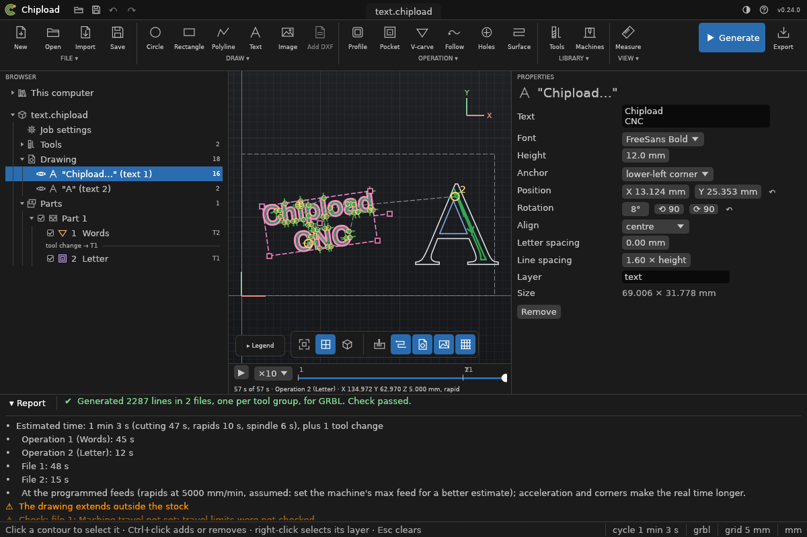
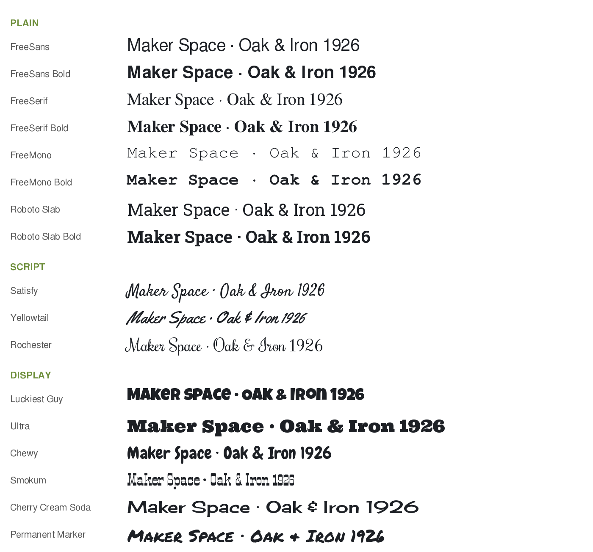

# Text

Write a name, a label or a sign straight into the project: Chipload turns the letters into
shapes that you [V-carve](../operations/vcarve.md), [pocket](../operations/pocket.md) or cut
out with a [profile](../operations/profile.md). (Design: `docs/specs/text.md`.)



## Writing a text

1. **Draw > Text** in the ribbon (or *DRAW > Text*), then click on the canvas where the text
   should start. That point is the lower-left corner of the text's box; set **Anchor** to
   centre afterwards to keep it centred on a point instead.
2. A text saying "Text" appears there, selected, with its properties open and the text field
   ready: type what it should say. **Enter** starts a new line. The letters are made again
   when you click elsewhere.
3. With the text selected, **V-carve** (or **Pocket**, **Profile**) in the ribbon cuts it. A
   new V-carve takes a V-bit from the project if it has one.

**Esc** stops placing a text.

## Properties

Click the text in the Browser (under *Drawing*, with an **A**) or one of its letters on the
canvas:
- **Text:** what it says, on one or more lines;
- **Font:** one of the built-in fonts, or one installed on your computer (below);
- **Height:** the height of a capital letter, mm; what a ruler measures on an H;
- **Anchor:** what Position is: the **lower-left corner** of the text's box, or its
  **centre**. A centred text stays centred when you change its words, font or size, which is
  handy for a name in the middle of a sign. Changing the anchor doesn't move the text;
- **Position:** the anchor's place on the stock, mm;
- **Rotation:** degrees counter-clockwise, any angle, about the box's centre, with ⟲ 90 and
  ⟳ 90;
- **Align:** how lines line up: left, centre or right;
- **Letter spacing:** extra space between letters, mm; 0 keeps the font's own spacing,
  kerning included (in a serif font, "AV" sits closer than "A V");
- **Line spacing:** from one line's base to the next, in capital heights (1.6 by default);
- **Layer:** the layer its letters go on (`text` by default);
- **Size:** the box's width and height, for reference.

Each change applies when you finish the edit, as one undo step: **Ctrl+Z** brings the
earlier text back. An operation that selects the text follows the change.

**On the canvas:** with the text selected, its box shows handles (in top view):
- the square in the **middle** moves it;
- the square beyond its right side **turns** it about its centre, in steps of 15°;
- a **corner** square makes it larger or smaller, keeping its proportions; the opposite
  corner stays where it is. Its height is rounded to 0.1 mm.

The box follows the cursor while you drag, and the text is written again when you let
go, as one undo step. Hold **Alt** for no steps (any angle, any size) and no snapping.

## Fonts

Chipload has 17 fonts built in, so a project writes the same letters on every computer. The
*Font* list groups them and shows each name in its own face; `chipload text fonts` lists
them with their style.



- **Plain:** FreeSans, FreeSerif and FreeMono, each also bold (GNU FreeFont), and Roboto
  Slab and Roboto Slab Bold.
- **Script:** Satisfy, Yellowtail and Rochester, handwriting with joined letters.
- **Display:** Luckiest Guy, Ultra, Chewy, Smokum, Cherry Cream Soda and Permanent Marker,
  bold and decorative, for headings and signs.

They all have the Latin letters with accents (Å, Ä, Ö, É, Ñ, Ø, …), digits and the common
symbols (€, °, ±; ⌀ only in some of the FreeFont faces). A character a font lacks is left
out, and the report names it.

**Joined letters:** where letters overlap, as in a script where one letter runs into the
next, or where a letter is drawn as overlapping strokes, Chipload joins them into one
outline, so a pocket or V-carve sees clean shapes. Holes stay holes where nothing covers
them. Letters that don't overlap anything keep the font's exact outline.

**Choosing:** serif fonts V-carve beautifully: the V-bit cuts the thin strokes shallow and
the thick ones deep. The scripts V-carve well too. For a pocket or a profile, a font with
even, sturdy strokes works best (FreeSans Bold, Roboto Slab, Ultra, Luckiest Guy, Chewy);
Smokum's pointed serifs need a pocketing tool of 2 mm or more.

**Licences:** GNU FreeFont is under the GPL with the font exception, the others under the
Apache License 2.0. Neither puts any condition on what you make: the letters you cut and
their G-code are yours.

### Your computer's fonts

The *Font* list also has **On this computer**: every TrueType or OpenType font installed
there, by name ("Arial Bold"), with a search field. Hover over a name to see a sample. The
first time the list opens, Chipload looks for them (*Looking for fonts…*).

A font you don't want to install can go in a folder named `fonts` in your
[settings folder](../install.md#your-settings); Chipload finds it there too.

Only the font's name goes into the project, never the font file: fonts are licensed to the
computer they are installed on. The letters are in the project as shapes, so the project
cuts the same on any computer (below).

## In the project file

A text is stored with what it says and how, and its letters are stored as shapes too. So the
font is needed only to change the text; a project cuts the same whatever the computer has
installed. Chipload 0.19 and older can't open a project that has a text.

**On a computer without the text's font,** the text keeps its letters and cuts as they
are. Its properties say so, and its words, height, alignment and spacing are greyed out;
the Browser marks it with ⚠. You can still move it, turn it and put it on another layer.
To change its words or size, choose another font: its letters are then made again in that
one.

## Leaving letters out

As with a picture: with the whole text selected, **Ctrl+click** a letter (or one part of it,
such as the hole of an O) to leave it out of the operation, and again to put it back. A
left-out letter is found again when the text changes size, place or font.

## Command line

```sh
chipload text add sign.chipload "MAKER\nSPACE" --height 20 --at 40,30 --font "FreeSerif Bold" --align center
chipload text set sign.chipload 1 --rotate 15 --spacing 1     # change it; its letters are made again
chipload text set sign.chipload 1 --anchor center --at 85,55  # centred on X85 Y55, and stays centred
chipload place sign.chipload --text 1 --at 10,10 --height 25  # its corner, turn and height
chipload text list sign.chipload
chipload text remove sign.chipload 1
chipload text fonts                                           # built in, then the computer's
```

`\n` in the text starts a new line. An operation selects the text with
`"select": {"text": 1}`, and any value can be changed with `chipload set`
(`drawing.texts.0.text="SIGN"`); the letters are made again.
