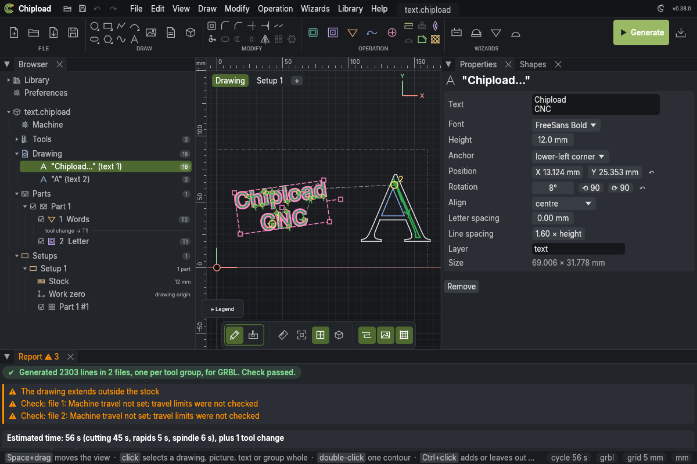
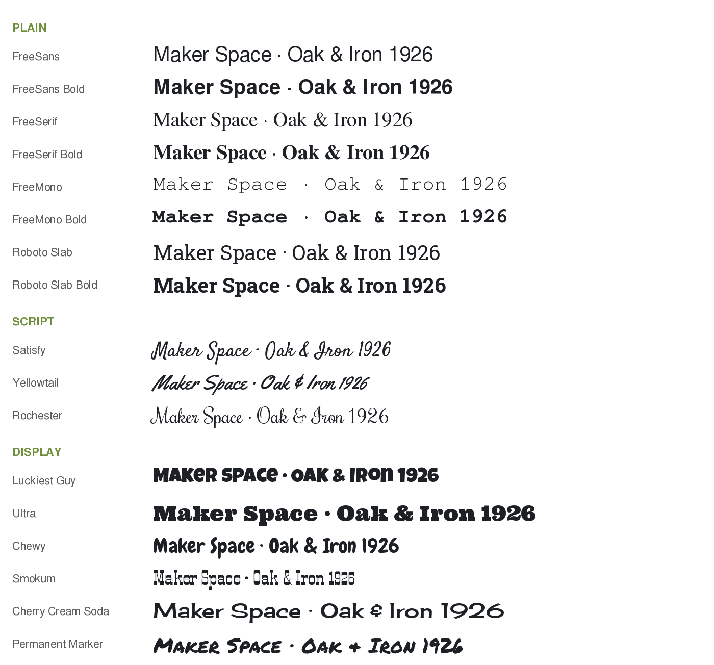

# Text

Write a name, a label or a sign straight into the project: Chipload turns the letters into
shapes that you [V-carve](../operations/vcarve.md), [pocket](../operations/pocket.md) or cut
out with a [profile](../operations/profile.md). (Design: `docs/specs/text.md`.)



For a sign, *Draw > Frame…* then draws a frame round the text, with border lines:
[Signs and frames](signs.md).

## Writing a text

1. **Text** among the ribbon's small DRAW buttons (or *Draw > Text*), then click on the canvas where the text
   should start. That point is the lower-left corner of the text's box; set **Anchor** to
   centre afterwards to keep it centred on a point instead.
2. A text saying "Text" appears there, selected, with its properties open and the text field
   ready: type what it should say. **Enter** starts a new line. The letters are made again
   when you click elsewhere.
3. With the text selected, **V-carve** (or **Pocket**, **Profile**) in the ribbon cuts it. A
   new V-carve takes a V-bit from the project if it has one.

**Esc** stops placing a text.

## Properties

Click the text in the Browser (under *Drawing*, with an **A**) or one of its letters on the
canvas:
- **Text:** what it says, on one or more lines;
- **Font:** one of the built-in fonts, or one installed on your computer (below);
- **Height:** the height of a capital letter, mm; what a ruler measures on an H;
- **Anchor:** what Position is: the **lower-left corner** of the text's box, or its
  **centre**. A centred text stays centred when you change its words, font or size, which is
  handy for a name in the middle of a sign. Changing the anchor doesn't move the text;
- **Position:** the anchor's place on the stock, mm;
- **Rotation:** degrees counter-clockwise, any angle, about the box's centre, with ⟲ 90 and
  ⟳ 90;
- **Align:** how lines line up: left, centre or right;
- **Letter spacing:** extra space between letters, mm; 0 keeps the font's own spacing,
  kerning included (in a serif font, "AV" sits closer than "A V");
- **Line spacing:** from one line's base to the next, in capital heights (1.6 by default);
- **Layer:** the layer its letters go on (`text` by default);
- **Size:** the box's width and height, for reference.

Each change applies when you finish the edit, as one undo step: **Ctrl+Z** brings the
earlier text back. An operation that selects the text follows the change.

**Del** removes the selected text with its letters (as *Remove* on its Browser row does).
To edit the letters by hand, right-click > **Explode into shapes…**: they become drawn
shapes, and the words can no longer be edited ([Exploding](explode.md)).

**On the canvas:** with the text selected, its box shows handles (in top view):
- the square in the **middle** moves it, and so does dragging one of its lines;
- the square beyond its right side **turns** it about its centre, in steps of 15°;
- a **corner** square makes it larger or smaller, keeping its proportions; the opposite
  corner stays where it is. Its height is rounded to 0.1 mm.

The box follows the cursor while you drag, and the text is written again when you let
go, as one undo step. Hold **Alt** for no steps (any angle, any size) and no snapping.

## On an arc

Tick **On an arc** in the text's properties and its line follows a circle, as on a round
plaque, a coaster or a badge. The circle's centre is the text's **Position** (anchor and
rotation don't apply then), and three more fields set the rest:
- **Radius:** of the circle through the middle of the letters, half a capital height above
  their base. A top text and a bottom text with the same radius lie in one ring;
- **Side:** **Top** stands the letters on the outside, reading clockwise, as a name along
  the top; **Bottom** keeps them upright at the bottom, reading counter-clockwise, as a
  date along the bottom;
- **Angle:** how far the text is turned round the circle from straight up (top) or
  straight down (bottom). With **Align** *centre* (which a text gets when it goes on an
  arc) its middle sits there; with *left* or *right*, its start or end.

Each letter is moved and turned whole onto the circle, so it keeps the font's exact shape;
on a top text their tops spread a little and their feet close in, as on any lettered ring.
More lines stack the way they're read: nearer the centre on the top, further out on the
bottom. A line longer than its circle, or one that would reach the centre, is refused
with the reason. On the canvas the box is the square round the ring: its middle moves the
circle, its turn handle moves the text round it, and a corner scales the radius and the
letters together.

## Fonts

Chipload has 18 fonts built in, so a project writes the same letters on every computer. The
*Font* list groups them and shows each name in its own face; `chipload text fonts` lists
them with their style.



- **Plain:** FreeSans, FreeSerif and FreeMono, each also bold (GNU FreeFont), and Roboto
  Slab and Roboto Slab Bold.
- **Script:** Satisfy, Yellowtail and Rochester, handwriting with joined letters.
- **Display:** Luckiest Guy, Ultra, Chewy, Smokum, Cherry Cream Soda and Permanent Marker,
  bold and decorative, for headings and signs.
- **Single-line:** Relief SingleLine, made for CNC engraving (below).

They all have the Latin letters with accents (Å, Ä, Ö, É, Ñ, Ø, …), digits and the common
symbols (€, °, ±; ⌀ only in some of the FreeFont faces). A character a font lacks is left
out, and the report names it.

**Joined letters:** where letters overlap, as in a script where one letter runs into the
next, or where a letter is drawn as overlapping strokes, Chipload joins them into one
outline, so a pocket or V-carve sees clean shapes. Holes stay holes where nothing covers
them. Letters that don't overlap anything keep the font's exact outline.

**Choosing:** serif fonts V-carve beautifully: the V-bit cuts the thin strokes shallow and
the thick ones deep. The scripts V-carve well too. For a pocket or a profile, a font with
even, sturdy strokes works best (FreeSans Bold, Roboto Slab, Ultra, Luckiest Guy, Chewy);
Smokum's pointed serifs need a pocketing tool of 2 mm or more.

**Licences:** GNU FreeFont is under the GPL with the font exception, Relief SingleLine
under the SIL Open Font License 1.1, the others under the Apache License 2.0. None puts any
condition on what you make: the letters you cut and their G-code are yours.

### Single-line text

The other fonts give each letter as the outline round its strokes, which suits a V-carve or
a pocket. A **single-line** font gives each stroke once, down its middle, as open lines and
arcs: one pass of a small bit cuts the letter. That is what labels, serial and part
numbers, scales, small lettering (under about 8 mm, where V-carved grooves run together)
and quick nameplates want.

- **Font:** *Relief SingleLine*, in the *Single-line* group of the font list. It has the
  Latin letters with accents of all the app's languages, digits and the common symbols,
  but no Cyrillic: write Russian in an outline font.
- **Cutting it:** a [Follow path](../operations/path.md) on the text, with a V-bit (the
  line as wide as the bit is deep) or a small end mill, at the depth you choose, 0.3 to
  1 mm for most engraving. Profile, Pocket and V-carve need closed outlines and refuse
  these letters, saying why.
- **Everything else as for any text:** height (the capital height), alignment, lines, on
  an arc, moved, turned and edited. Strokes that cross are each cut; they aren't joined.
- **On the command line:** `chipload text add P "PART 42-A" --font "Relief SingleLine"
  --height 6 --at 10,10`, then `chipload op add P path --layer text --depth 0.5`.

### Your computer's fonts

The *Font* list also has **On this computer**: every TrueType or OpenType font installed
there, by name ("Arial Bold"). Hover over a name to see a sample. The first time the list
opens, Chipload looks for them (*Looking for fonts…*).

When the list opens you can type at once: the **search** field at its top keeps only the
fonts whose name has what you typed, built in and on this computer. **Recently used**, at
the top, has the last five fonts you picked, each in its own face.

A font you don't want to install can go in a folder named `fonts` in your
[settings folder](../install.md#your-settings); Chipload finds it there too.

Only the font's name goes into the project, never the font file: fonts are licensed to the
computer they are installed on. The letters are in the project as shapes, so the project
cuts the same on any computer (below).

## In the project file

A text is stored with what it says and how, and its letters are stored as shapes too. So the
font is needed only to change the text; a project cuts the same whatever the computer has
installed. Chipload 0.19 and older can't open a project that has a text.

**On a computer without the text's font,** the text keeps its letters and cuts as they
are. Its properties say so, and its words, height, alignment and spacing are greyed out;
the Browser marks it with ⚠. You can still move it, turn it and put it on another layer.
To change its words or size, choose another font: its letters are then made again in that
one.

## Leaving letters out

As with a picture: with the whole text selected, **Ctrl+click** a letter (or one part of it,
such as the hole of an O) to leave it out of the operation, and again to put it back. A
left-out letter is found again when the text changes size, place or font.

## Command line

```sh
chipload text add sign.chipload "MAKER\nSPACE" --height 20 --at 40,30 --font "FreeSerif Bold" --align center
chipload text set sign.chipload 1 --rotate 15 --spacing 1     # change it; its letters are made again
chipload text set sign.chipload 1 --anchor center --at 85,55  # centred on X85 Y55, and stays centred
chipload text add plaque.chipload "MAKER SPACE" --height 12 --at 0,0 --arc 60   # along the top of a circle round 0,0
chipload text add plaque.chipload "EST. 2026" --height 8 --at 0,0 --arc 60 --side bottom
chipload text set plaque.chipload 1 --angle 100               # turned round the circle; --straight: off the arc
chipload place sign.chipload --text 1 --at 10,10 --height 25  # its corner, turn and height
chipload text list sign.chipload
chipload text remove sign.chipload 1
chipload text fonts                                           # built in, then the computer's
```

`\n` in the text starts a new line. An operation selects the text with
`"select": {"text": 1}`, and any value can be changed with `chipload set`
(`drawing.texts.0.text="SIGN"`); the letters are made again.
