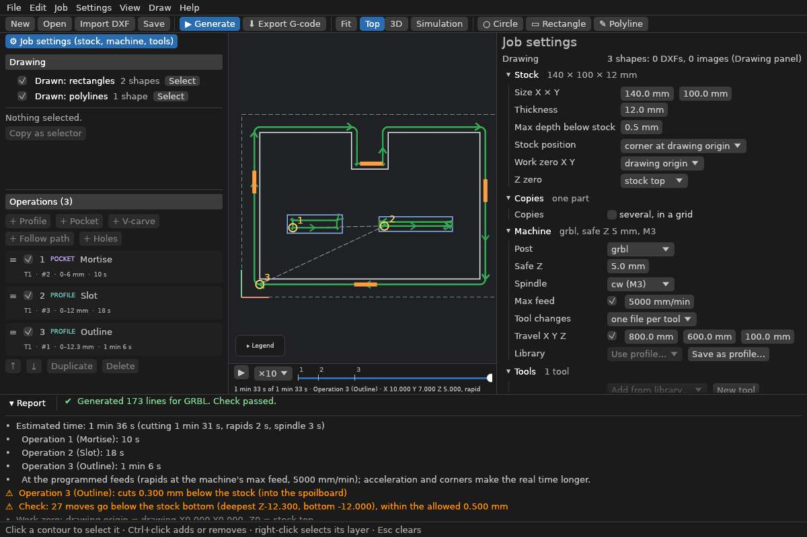

# Your first part

This walks through one part, from a DXF to G-code: a plate with holes, cut out with an
outside profile. The same steps follow in the app and on the command line.

## In the app

1. **Import the drawing:** *File > Import DXF…* (Ctrl+I).
   - If the DXF doesn't say whether it's in mm or inches, Chipload asks. It never guesses.
   - The report under the canvas lists what was imported, and anything skipped or
     repaired: duplicate lines, gaps it closed, splines turned into arcs.
2. **Check the job settings:** click **Job settings** in the [Browser](window.md#the-browser)
   on the left. A new project starts with:
   - stock just covering the drawing, 10 mm thick;
   - work zero at the drawing's origin, Z zero on the stock top;
   - the GRBL post, a safe height of 5 mm;
   - a 6 mm endmill at 18 000 rpm.

   With a [tool library](library/tools.md) and [machine profiles](library/machines.md) set up, your
   defaults come instead. Set the real stock thickness now: depths are measured from its
   top.
3. **Select what to cut:**
   - click the outline on the canvas;
   - Ctrl+click adds more;
   - right-click selects a whole layer;
   - or click a DXF or one of its layers in the Browser.
4. **Add an operation:** **Profile**, in the ribbon's OPERATION group.
   - **Side:** Chipload picks *outside* for an outline and *inside* for holes, and asks
     when a selection mixes both.
   - **End depth:** for a cut-out, the stock thickness plus a little, e.g. 10.3 mm into a
     spoilboard. More than the allowed overcut (0.5 mm by default, under Job settings) is
     refused.
   - **Step down:** how deep each pass goes.
   - **Tabs:** they keep the part from coming loose on the last pass. Add them under
     *Tabs*.
5. **Generate:** F5, or leave *View > Update toolpath automatically* on.
   - The toolpath shows on the canvas: arrows give the cutting direction, rapids are
     dashed, and each operation's number sits at its first plunge.
   - Problems show in red on the field they're about.
   - Warnings appear in the report.

   
6. **Look at it:** **3D** shows the toolpath at its real depths. *View > Show stock*
   shows the stock as cut, and the slider under the canvas plays the program back.
7. **Export:** *File > Export G-code…* (Ctrl+E).
   - You can only export once the [checker](#the-checker) has passed the program.
   - Next to the G-code comes a setup sheet (`part-sheet.html`) for the operator: stock,
     zero, tools in order, operations and times.
8. **Save the project:** Ctrl+S. A project (`.chipload`) keeps the drawing itself, so the DXF
   isn't needed again unless it changes.

## On the command line

```sh
chipload import plate.dxf -o plate.chipload        # add --units mm if the DXF doesn't say
chipload inspect plate.chipload                    # contours with their numbers and layers
chipload set plate.chipload stock.thickness=12 \
  'operations.0={"type": "profile", "name": "Outline", "select": {"layer": "CUT_OUTSIDE"},
    "side": "outside", "direction": "climb", "tool": 1, "start_depth": 0,
    "end_depth": 12.3, "clearance": 0, "step_down": 3, "feed": 1500, "plunge_feed": 400,
    "tabs": {"count": 4, "width": 6, "height": 2, "flank_angle": 1.5707963267948966}}'
chipload plan plate.chipload                       # warnings, cycle time, chip load
chipload run plate.chipload -o plate.nc            # checked G-code and plate-sheet.html
```

- `set` adds the operation (see [Scripting](scripting.md)).
- `select` picks the outline by its layer, as `inspect` lists it. To pick single shapes
  instead, use `{"shapes": [ids]}`: `inspect --json` gives each contour's shape ids.
- Angles in project files are in radians: 1.5707963267948966 is 90°, a straight tab.
- The app makes the same project. Open `plate.chipload` in it to see and change the
  operation.

## The checker

Before Chipload writes a program, an independent checker reads the G-code back and refuses
it if it finds, among other things:
- a rapid move (G0) down into the stock, or sideways while the tool is below the safe
  height;
- a cut deeper than the stock bottom plus the allowed overcut;
- a move beyond the machine's travel, when the travel is set;
- an arc whose ends don't lie on its circle;
- a cutting move with no feed, or with the spindle off;
- inch or relative coordinates;
- a tool change with the spindle running or below the safe height.

The checker is separate code that shares nothing with the part of Chipload that makes the
toolpath, so a bug in one is likely caught by the other. `chipload check part.nc --job
part.chipload` runs it on any G-code, also from other programs.

## Before you cut

- **Work zero:** the setup sheet says where X0 Y0 and Z0 are. Set them on the machine
  exactly there.
- **Clamps:** look at the 3D view or the simulation for clamps in the toolpath.
  Chipload doesn't know where your clamps are.
- **Air cut:** run the program once above the stock.
- **What holds the part:** in the last pass, tabs or an onion skin should keep it in
  place.
