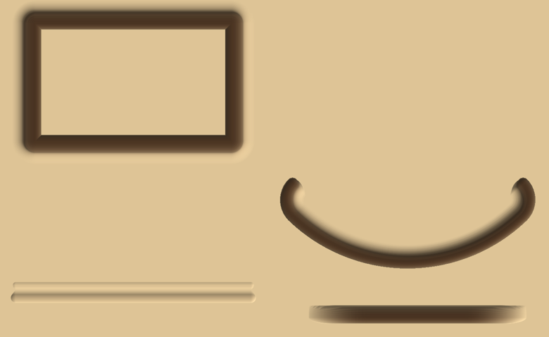

# Moulding

**Moulding** sweeps a profile along a path: a cove or an ogee round a table top's face, a
bead along a door frame, a round-over beside a raised panel, a decorative band across a
lid. You give the path (the line the moulding runs along) and the profile (its
cross-section); a ball nose cuts it in passes along the path.



Select the paths (open or closed shapes), then press **S** over the canvas and **M**, or
choose **Operation > New Moulding**, or *New operation* in a part's right-click menu in the
Browser.

## The profile

| Profile | Settings | Cross-section |
|---|---|---|
| **Cove** | Radius | a hollow quarter circle: as deep as the radius at the path, at the surface the radius in |
| **Round-over** | Radius | the edge rounded: a convex quarter circle |
| **Ogee** | Width, Depth | an S: a cove into a round-over |
| **Bead** | Radius | a raised half round, its top at the surface |
| **Flute** | Radius | a half-round groove |
| **Drawn shape** | Shape | any open shape you draw, read as the section |

**A drawn profile** is the section as you would draw it on paper: across to the right
(away from the path), up the page. Its leftmost point is at the path, its highest point is
the surface; where it doubles back, the lowest part counts. Draw it as **construction
geometry** (so it is never cut itself), anywhere on the canvas. Change the shape, and the
moulding follows.

## The side and the ends

- **Side:** *outside* or *inside* a closed path, *left* or *right* of an open path as it
  was drawn. A new moulding takes outside for an outline, inside for a hole, left for an
  open path.
- **Corners:** at a corner turning away from the profile, the moulding turns round it; at
  a corner turning towards it, the two meet in a mitre, as a mitred frame's corner.
- **Ends** of an open path:
  - **square:** the full profile to the path's end, for a moulding that runs off the
    board's edge;
  - **round:** the profile turns a quarter round the path's end point, as a moulding bit
    stopped and lifted out leaves it;
  - **tapered:** the moulding fades into the board over a length, straight or curved, as
    a stopped flute does. Along the taper the tool rises and falls with the section.

## How it cuts

For each distance from the path, the tool goes as deep as its own shape allows without
cutting below the profile: Chipload drops the tool's shape onto the section. Each pass is
the path's offset at that distance, cut at that depth, one **stepover** apart across the
profile, so the finish runs along the moulding. With a **step down**, a deep profile is
cut in levels, each pass no deeper than its level. The tool lifts between passes.

Where the profile has a curve tighter than the tool, or a wall the ball can't reach (the
sides of a bead, a vertical step in a drawn profile), the tool bridges it; a note says how
far it stays above the profile there. A smaller ball, or an end mill, reaches further.

The first pass runs on the path itself, so with a ball nose half the tool cuts beyond the
path at the profile's depth there: right for a cove, ogee or round-over at a part's edge,
where beyond the path is waste. A profile that starts at the surface (a bead, a flute, a
drawn band) cuts nothing beyond the path.

## Settings

| Setting | |
|---|---|
| **Tool** | a ball nose (the usual) or an end mill; a V-bit or a drill is refused |
| **Profile** | the shape and its size, or the drawn shape. The list shows each profile's section beside its name, and a drawing of the chosen one, true to scale, sits under its size: the board with the profile cut into it, the path at the mark, the tool at its deepest pass and a dot where each pass's tip goes |
| **Side**, **Ends** | as above; *Taper length* and its ramp shape for tapered ends |
| **Start depth** | where the surface is: 0 for the stock top |
| **Stepover** | the distance between passes across the profile; a new moulding takes the widest that leaves ridges of 0.02 mm with a ball nose, a quarter of an end mill |
| **Step down** | off: one level. On: equal levels no deeper than this |
| **Direction** | climb or conventional |
| **Feed**, **Plunge feed** | mm/min |

A new moulding takes the project's first ball nose (else its first end mill), a 6 mm cove,
square ends, the tool's step down, climb. The report gives the profile's depth and the
number of passes. The setup sheet says, for example, "Moulding, cove R 6, outside,
stepover 0.6, climb".

## Command line

```
chipload op add part.chipload moulding --shapes 1 --profile cove --radius 8
chipload op add part.chipload moulding --shapes 2 --profile ogee --width 12 --depth 6 --side right
chipload op add part.chipload moulding --shapes 3 --ends taper --taper 30 --ramp-shape curved
chipload op add part.chipload moulding --shapes 4 --profile-shape 7 --ends round
chipload set part.chipload operations.0.profile.radius=6
```

`--side` is `outside`, `inside`, `left` or `right`; `--stepover` sets the stepover. A
moulding takes no `--through`.

## In the file

`"type": "moulding"` in the [project file](../reference/project-file.md#operation). Lengths
are in mm, feeds in mm/min. A project with a moulding opens in Chipload 0.37.0 and later.

| Field | Setting |
|---|---|
| `name` | Name |
| `enabled` | the tick on the operation's row in the Browser |
| `part` | the [part](parts.md) it belongs to |
| `select` | the paths: `{"layer": "NAME"}` or `{"shapes": [ids]}` |
| `tool` | Tool: the project tool's id |
| `profile` | Profile: `{"kind": "cove", "radius"}`, `{"kind": "roundover", "radius"}`, `{"kind": "ogee", "width", "depth"}`, `{"kind": "bead", "radius"}`, `{"kind": "flute", "radius"}` or `{"kind": "shape", "shape": ID}` |
| `side` | Side: `outside`, `inside`, `left` or `right` |
| `ends` | Ends: `{"kind": "square"}`, `{"kind": "round"}` or `{"kind": "taper", "length", "shape"}` (`straight` or `curved`) |
| `start_depth` | Start depth |
| `stepover` | Stepover |
| `step_down` | Step down; `null` for one level |
| `direction` | Direction: `climb` or `conventional` |
| `feed` | Feed |
| `plunge_feed` | Plunge feed |
