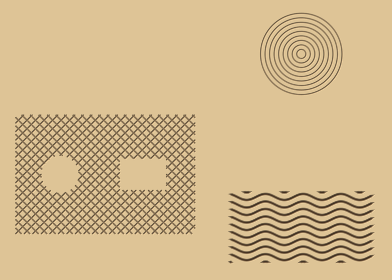
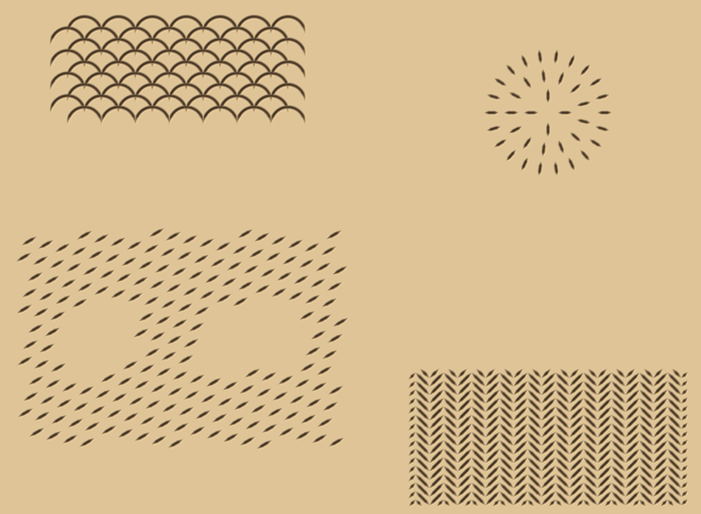

# Pattern

**Pattern** engraves a texture of grooves inside closed shapes: lines, a cross-hatch,
rings or waves. Use it for the background of a sign behind raised letters, a door panel, a
box lid or a coaster. The grooves stop at the shape's edge and leave its holes alone.



Select the shapes, with the shapes inside them that should stay untouched (the letters of
a sign), then **Pattern** (ribbon, OPERATION, the small button under Flute), or press **S** over
the canvas, then **E**.

## What it fills

The shapes are taken as a [pocket](pocket.md) takes them: a selected shape is filled, and
the selected shapes inside it are holes. Shapes inside that aren't selected don't count.
Open shapes are skipped with a note.

- **Inside the edge** (on for a new pattern): the grooves stop half a groove's width in
  from the line, so none cuts past the shape or into a hole. Off: they run up to the line,
  centred on it; use it when the edge is cut away or covered later.
- Pieces shorter than a groove's width are left out.

## Patterns

| Pattern | Settings | Grooves |
|---|---|---|
| **Lines** | Angle, Spacing | parallel lines |
| **Cross-hatch** | Angle, Spacing, Angle between | two sets of lines: 90° between gives squares, 60° diamonds |
| **Rings** | Spacing | the outline repeated inwards, and round the holes |
| **Waves** | Angle, Spacing, Wavelength, Height | parallel waves; the height is from top to bottom |

**Patterns of short strokes**, for a fluted texture: each stroke is a groove of its own,
so with ramped ends (see *Ends* below) every stroke tapers to a point at both ends, as a
flute does.



| Pattern | Settings | Strokes |
|---|---|---|
| **Dashes** | Angle, Spacing, Stroke length, Gap | rows of strokes with gaps between, every other row shifted half a stroke and gap, as bricks |
| **Herringbone** | Angle, Spacing, Stroke length | columns of strokes at 45°, the next column mirrored, meeting in chevrons |
| **Scales** | Angle, Spacing, Radius | rows of half circles side by side, every other row shifted by a radius |
| **Sunburst** | Spacing, Stroke length, Pitch | round the middle of each shape: rings of strokes pointing outwards, *pitch* apart round the ring, every other ring turned half a pitch |

- **Whole strokes only** (on for a new stroke pattern): a stroke the shape's edge or a hole
  would cut is left out, so every stroke keeps both tapered ends. Off: strokes are clipped
  at the edge, as lines are.
- Choosing a stroke pattern fills in sizes from the groove's width (strokes three widths
  long, at least 4 mm) and, if the ends were square, ramps of a third of a stroke.

- **Spacing** is from one groove's centre to the next. Narrower than a groove, the grooves
  overlap (a note says so) and the area comes out roughened.
- **Angle** is the lines' direction from the X axis, counter-clockwise.
- Lines and waves are laid out from the drawing's origin, so a pattern carries on unbroken
  from one shape to the next.

## How it cuts

Every groove is cut at one depth, in passes if a step down is set. Each groove is cut
like a [flute](flute.md): back and forth through its passes without lifting, then the tool
retracts and moves to the next groove. Rings go down where they start, as a closed
[follow path](path.md).

**Ends:** square, the tool going straight down; or ramped in and out over a length, as a
flute's, so with a V-bit each groove ends in a point and the texture looks softer.

A pattern with more than 50 000 grooves is refused: widen the spacing.

## Settings

| Setting | |
|---|---|
| **Tool** | a V-bit (the usual, no deeper than its cone), a ball nose or an end mill. A drill is refused |
| **Pattern** | Lines, Cross-hatch, Rings or Waves, and their settings above |
| **Inside the edge** | grooves inside the line (on) or up to it (off) |
| **Start depth** | 0 for the stock top, more for a pattern in the floor of a pocket |
| **Depth** | the grooves' depth; each groove's width at the top is shown beneath |
| **Step down** | off: one pass. On: equal passes no deeper than this |
| **Ends** | 0 for square ends, or the length each groove ramps in and out |
| **Feed**, **Plunge feed** | mm/min |

A new pattern takes the project's first V-bit, 0.5 mm deep (no deeper than its cone),
lines at 45°, the spacing twice the groove's width (at least 1 mm), inside the edge, with
square ends.

The setup sheet says, for example, "Pattern, cross-hatch 4 mm apart at 45°, 90° between,
inside the edge".

## Command line

```
chipload op add part.chipload pattern --shapes 1,2,3 --pattern cross --spacing 4 --angle 45
chipload op add part.chipload pattern --layer PANEL --pattern waves --spacing 5 --wavelength 25 --height 4 --ramp 3
chipload op add part.chipload pattern --shapes 4 --pattern rings --spacing 3 --on-line
chipload set part.chipload operations.0.pattern.spacing=5
```

`--between` sets a cross-hatch's angle between (90 if left out); `--wavelength` and
`--height` a wave's (4 spacings and one spacing if left out); `--ramp` the ends;
`--on-line` turns off *Inside the edge*. A pattern takes no `--through`.

Stroke patterns: `--pattern dashes|herringbone|scales|sunburst`, with `--length`, `--gap`,
`--radius` and `--pitch`; `--clip` turns off *Whole strokes only*. Without `--ramp` they
are fluted:

```
chipload op add part.chipload pattern --shapes 1,2,3 --pattern dashes --length 6 --gap 3 --angle 30
chipload op add part.chipload pattern --shapes 4 --pattern sunburst --pitch 5
```

## In the file

`"type": "pattern"` in the [project file](../reference/project-file.md#operation). Lengths
are in mm, angles in radians, feeds in mm/min. A project with a pattern opens in Chipload
0.37.0 and later.

| Field | Setting |
|---|---|
| `name` | Name |
| `enabled` | the tick on the operation's row in the Browser |
| `part` | the [part](parts.md) it belongs to |
| `select` | the geometry: `{"layer": "NAME"}` or `{"shapes": [ids]}` |
| `tool` | Tool: the project tool's id |
| `pattern` | Pattern: `{"kind": "lines", "angle", "spacing"}`, `{"kind": "cross", "angle", "spacing", "between"}`, `{"kind": "rings", "spacing"}`, `{"kind": "waves", "angle", "spacing", "wavelength", "height"}`, `{"kind": "dashes", "angle", "spacing", "length", "gap", "whole"}`, `{"kind": "herringbone", "angle", "spacing", "length", "whole"}`, `{"kind": "scales", "angle", "spacing", "radius", "whole"}` or `{"kind": "sunburst", "spacing", "length", "pitch", "whole"}` |
| `inside` | Inside the edge |
| `start_depth` | Start depth |
| `end_depth` | Depth |
| `step_down` | Step down; `null` for one pass |
| `ramp` | Ends; 0 for square |
| `feed` | Feed |
| `plunge_feed` | Plunge feed |
