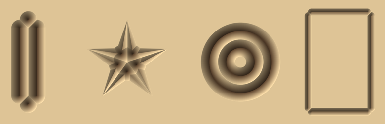

# Prism

**Prism** leaves closed shapes standing as roofs: their sides slope up from the edges to a
sharp ridge along the centre line, as hand-chiselled raised letters. It is the opposite of
a [V-carve](vcarve.md), which sinks the shape into the board, and it uses the same drawing
and the same V-bit.



Select the shapes, with the shapes inside them that are holes (an O's counter), then press
**S** over the canvas and **R**, or choose **Operation > New Prism**, or *New operation*
in a part's right-click menu in the Browser.

## How it cuts

The V-bit's tip runs once round each outline, going as deep as the shape is wide there:
the radius of the largest circle inside the shape that touches the outline at that point,
over the tangent of half the bit's angle. The bit's inner flank then reaches the surface
exactly on the centre line, so one lap round the outline cuts the whole roof.

- A stroke 10 mm wide comes out as a ridge 5 mm high with a 90° bit, 8.7 mm with a 60° bit.
- At a sharp outside corner the edge comes up to the surface, so corners end in points, as
  a chiselled serif does. Where strokes meet, the junction rises to a peak.
- With a flat-tipped bit, the tip runs half its width outside the line, so the edge has no
  step.
- Each lap starts at its shallowest point, at the surface where the shape has a corner.

**Wider than the bit:** where a shape is wider than the bit's cone can bring to a ridge,
its edges go as deep as the cone allows and the middle stays flat, at the surface. A note
says which shape. **Max depth** does the same on purpose: bevelled raised shapes with a
flat top, every edge no deeper than you set.

**Round the shapes:** the bit's other flank cuts outwards, leaving a V-shaped trench round
each shape as deep as its edge. Leave it for a carved-in look, or clear the background
first with a [pocket](pocket.md) as deep as the deepest edge (the report says how deep)
for shapes standing on a flat background. Where shapes stand so close that one's trench
reaches the next, that shape's lower edge is cut into: a note names the two shapes and
how much deeper the edge goes there; space them further apart, or set a max depth.

Open shapes are skipped with a note.

## Settings

| Setting | |
|---|---|
| **Tool** | a V-bit with its angle; any other tool is refused |
| **Start depth** | where the surface is: 0 for the stock top, more for a prism in the floor of a pocket |
| **Max depth** | off: as deep as the shapes and the bit's cone need. On: no deeper than this, for bevelled shapes with a flat top. Beneath it, how deep the edges can go with the bit |
| **Step down** | off: one lap. On: equal passes, each the same lap no deeper than its level |
| **Direction** | climb or conventional |
| **Feed**, **Plunge feed** | mm/min |

A new prism takes the project's first V-bit, no max depth, the tool's step down, climb.

The report gives the deepest edge ("the deepest edge is 6 mm"). The setup sheet says
"Prism, climb", with the depths "0 to at most 6.35" (the bit's cone or the max depth).

## Command line

```
chipload op add part.chipload prism --shapes 1,2,3
chipload op add part.chipload prism --layer LETTERS --max-depth 3
chipload set part.chipload operations.0.max_depth=2.5
```

`--max-depth` gives a flat top; a prism takes no `--depth` or `--through`, as its depth
follows from the shapes.

## In the file

`"type": "prism"` in the [project file](../reference/project-file.md#operation). Lengths
are in mm, feeds in mm/min. A project with a prism opens in Chipload 0.37.0 and later.

| Field | Setting |
|---|---|
| `name` | Name |
| `enabled` | the tick on the operation's row in the Browser |
| `part` | the [part](parts.md) it belongs to |
| `select` | the geometry: `{"layer": "NAME"}` or `{"shapes": [ids]}` |
| `tool` | Tool: the project tool's id, a V-bit |
| `start_depth` | Start depth |
| `max_depth` | Max depth; `null` for as deep as needed |
| `step_down` | Step down; `null` for one pass |
| `direction` | Direction: `climb` or `conventional` |
| `feed` | Feed |
| `plunge_feed` | Plunge feed |
