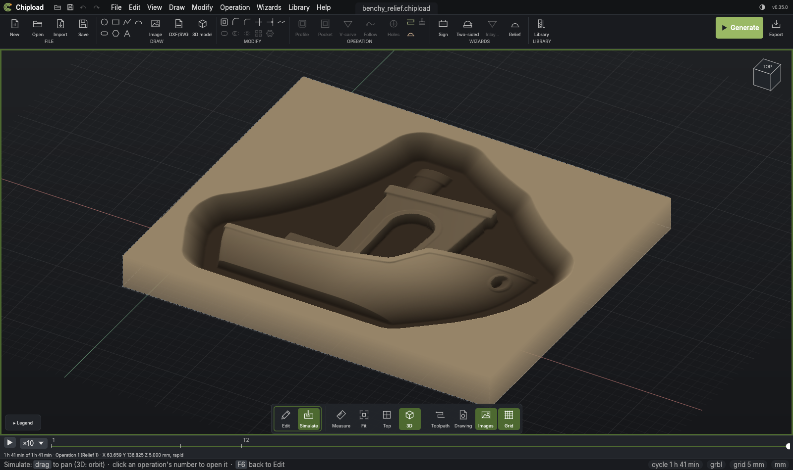

# Relief

A **relief** carves a 3D model into the board from the top: an STL file, a picture read as a
depth map, or a picture's black shapes inflated into rounded ones. The tool follows the
model in parallel lines, each point as low as it can go without cutting into the model, so
a ball nose leaves a smooth surface; nothing under an overhang is reached.

Everything about it is on the [3D models](../drawings/models.md) page, as a relief is
made from a model:
- [A relief in one step](../drawings/models.md#a-relief-in-one-step): the *Relief…*
  wizard, or `chipload relief add`.
- [Adding a model](../drawings/models.md#adding-a-model), [a relief from a
  picture](../drawings/models.md#a-relief-from-a-picture) and [inflated
  shapes](../drawings/models.md#inflated-shapes).
- [The Relief operation](../drawings/models.md#carving-it-the-relief-operation): its
  lines, stepover, angle, start depth and depth.
- [A rim and a ramp](../drawings/models.md#a-rim-and-a-ramp): a flat round the model and a
  ramp up to the surface, *Fuller* filling the outline out.
- [Roughing first](../drawings/models.md#roughing-first) and [smoothing the
  steps](../drawings/models.md#smoothing-the-steps): the passes before the finish.
