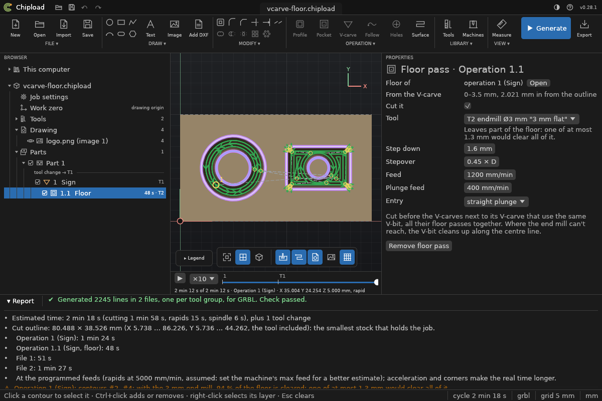

# V-carve

A V-carve engraves closed shapes, such as lettering (converted to outlines in CAD), logos
and inlay outlines, with a V-bit:
- the bit follows each shape's centre line;
- it goes as deep as makes the cut exactly as wide as the shape at the surface.

Narrow strokes come out shallow and wide ones deep, and sharp outside corners such as serif
tips stay sharp. Select the closed contours, then **V-carve** (ribbon, OPERATION). A logo or sketch that is
only a picture can be [traced into shapes](../drawings/images.md) first.

## The V-bit

The tool must be a **V-bit** with its **angle** set: the included angle, e.g. 60° or 90°.
**Tip** is the flat tip's diameter, 0 for a pointed bit. Chipload never guesses the angle;
a V-bit without one is refused.

## Settings

| Setting | |
|---|---|
| **Start depth** | where the carved surface is: 0 for the stock top, more to carve into a floor an earlier pocket cut |
| **End depth** | the deepest the tip may go. Strokes that need more get walls (see *Wide strokes*). The bit's own size is a limit too: it can't go deeper than its cutting edge reaches. |
| **Step down** | optional: carve in passes, each only where the last stopped short |
| **Feed**, **Plunge feed** | moves steeper than 45° use the plunge feed |

Regions work as in pockets: an outline minus the selected contours inside it (the inside of
an O stays standing). Open contours are skipped.

## Wide strokes

Where a stroke is wider than the bit can carve within the end depth, the bit goes down to
the end depth and follows the outline, just far enough in for its cone to touch the drawn
edge at the surface. The walls come out as drawn, sharp, at the bit's angle; narrow parts
of the same shape are still carved along their centre line, and corners are carved up into
their tips.

Without more, the floor between the walls is left standing at the surface, with a
warning: an outline carving.

### The floor pass

To clear the floor flat, give the V-carve a **floor pass**: an end mill that clears the
floor at the end depth, kept clear of the sloped walls. It belongs to the V-carve, as a rest
pass belongs to its pocket: it takes the V-carve's shapes and depths, has its own tool,
feeds, step down and stepover, and is cut first, so the end mill takes the bulk and the
V-bit only cuts the walls. Where the end mill can't reach (corners of the floor, parts
narrower than it), the V-bit cleans up along the centre line at the end depth.

In the window, right-click the V-carve in the Browser: **Add floor pass ▸** lists the
project's end mills, then your library's. The floor pass is a leaf under the V-carve; click
it for its settings.



If the end mill is too wide for part of the floor, the plan says how much it clears and the
largest end mill that would clear it all, and names the end mills in your library that do
(in the floor pass's settings too, under its tool):

```text
warning: Operation 1 (Logo): contours #2, #4: with the 6 mm end mill, 85 % of the floor is cleared; one of at most 0.9 mm would clear all of it
Operation 1: end mills in your library that clear the floor: 0.8 mm flat (0.8 mm)
```

Specks lower than 0.2 mm, or less than 1 % of a shape's floor, don't count: no round end
mill reaches into a sharp corner. The advice is information only; the job runs either way.

```sh
chipload op add-floor sign.chipload --op 1 --tool 2   # the floor pass with project tool 2
chipload op remove-floor sign.chipload --op 1
```

## Limits

- **A flat tip:** it can't reach into the last bit of a sharp corner, and strokes narrower
  than the tip are left out, with a warning.
- **Text:** text from the DXF must be converted to outlines (curves) in CAD first. Chipload
  doesn't read TEXT entities or fonts.

Every V-carve move is checked so the cone never reaches past the outline at the surface.

## In the file

`"type": "vcarve"` in the [project file](../reference/project-file.md#operation). Lengths are
in mm, feeds in mm/min, angles in radians.

| Field | Setting |
|---|---|
| `name` | Name |
| `enabled` | the tick on the operation's row in the Browser |
| `part` | the [part](parts.md) it belongs to |
| `select` | the geometry: `{"layer": "NAME"}` or `{"shapes": [ids]}` |
| `tool` | Tool: the project tool's id |
| `start_depth` | Start depth |
| `end_depth` | End depth |
| `step_down` | Step down, or null for one pass |
| `feed` | Feed |
| `plunge_feed` | Plunge feed |
| `floor` | the floor pass, left out when there is none: `tool` (an end mill), `feed`, `plunge_feed`, `step_down`, `stepover` (a fraction of the end mill's diameter), `entry` and `enabled` |
