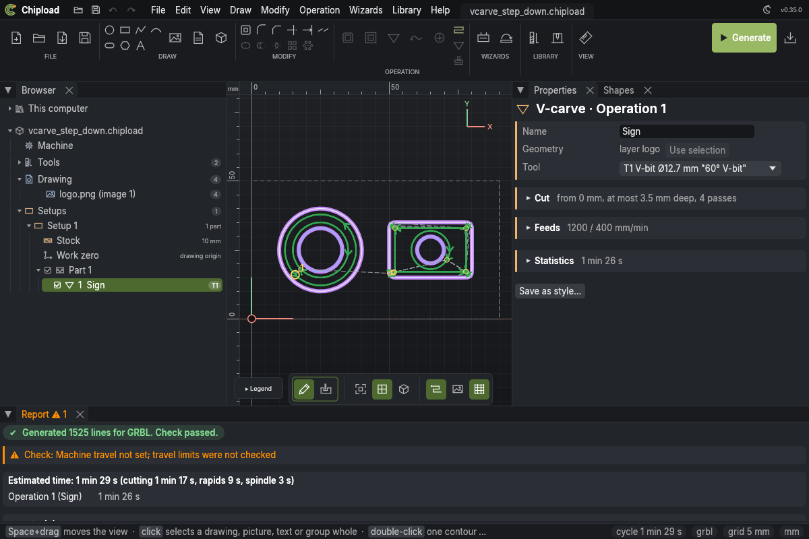
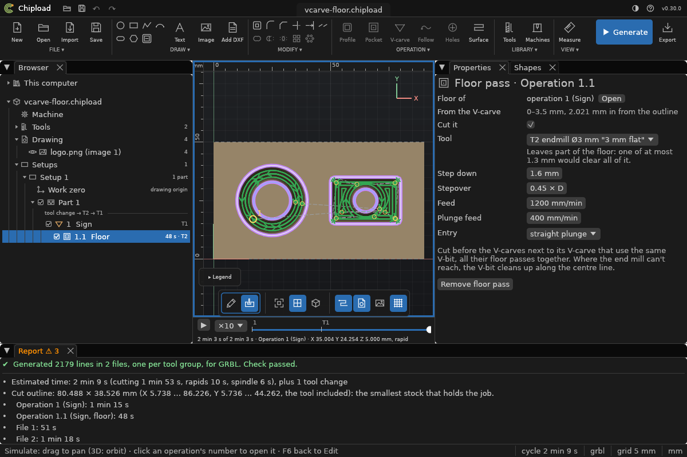

# V-carve

A V-carve engraves closed shapes, such as lettering (converted to outlines in CAD), logos
and inlay outlines, with a V-bit:
- the bit follows each shape's centre line;
- it goes as deep as makes the cut exactly as wide as the shape at the surface.

Narrow strokes come out shallow and wide ones deep, and sharp outside corners such as serif
tips stay sharp. Select the closed contours, then **V-carve** (ribbon, OPERATION). A logo or sketch that is
only a picture can be [traced into shapes](../drawings/images.md) first.

## The V-bit

The tool must be a **V-bit** with its **angle** set: the included angle, e.g. 60° or 90°.
**Tip** is the flat tip's diameter, 0 for a pointed bit. Chipload never guesses the angle;
a V-bit without one is refused.

## Settings

| Setting | |
|---|---|
| **Start depth** | where the carved surface is: 0 for the stock top, more to carve into a floor an earlier pocket cut |
| **End depth** | the deepest the tip may go. Strokes that need more get walls (see *Wide strokes*). The bit's own size is a limit too: it can't go deeper than its cutting edge reaches. |
| **Depth passes** | how the depth is split into passes: **Equal load** or **Step down** (see *Passes*) |
| **Passes** | with *Equal load*: how many passes to the end depth, 1 for one. Each removes as much as the others, so they get shallower on the way down. Their depths are shown under the field |
| **Step down** | with *Step down*: the deepest each pass goes. The passes are equal, the last at the end depth, as in a pocket. Their depths are shown under the field |
| **Ignore kinks** | corners where the outline bends less than this angle (20° for a new V-carve) get no branch of the centre line, so the bit doesn't rise into every kink of a curve (see *Smooth carving*); 0° carves every corner. In the project file: `ignore_kinks_deg` |
| **Feed**, **Plunge feed** | moves steeper than 45° use the plunge feed |

Regions work as in pockets: an outline minus the selected contours inside it (the inside of
an O stays standing). Open contours are skipped.

## Passes

A V groove gets wider as it gets deeper: twice as deep removes four times as much. Passes
of the same depth get heavier and heavier, the last one the hardest on the bit and the
machine. *Depth passes* chooses how the depth is split:

- **Equal load** (a new V-carve's choice): you say in how many passes, and each pass removes
  the same amount, so the steps get smaller on the way down. 5 mm in 6 passes goes to 2.04,
  2.89, 3.54, 4.08, 4.56 and 5 mm; 3 mm in 3 passes to 1.73, 2.45 and 3 mm. More passes are
  lighter on the bit and take longer.
- **Step down**: you say how deep each pass may go, as for a pocket, and the passes are
  equal steps. 5 mm with a 2 mm step down goes to 1.67, 3.33 and 5 mm. Each pass removes
  more than the one before (with three, 1 : 3 : 5), so pick a step the last pass can take.

Either way, the depths are counted from the end depth, so a stroke that is shallower than
that is done in fewer passes: the deeper ones find nothing left to cut. Switching from one
to the other keeps the count of passes, for when you switch back.

The carving is done area by area: each letter (or each closed part of a drawing, such as
the dot of an *i*) gets all its passes, and its walls, before the bit moves to the
nearest next one.

Within a letter the bit lifts as little as it can. The short branches the centre line
runs into sharp corners (shorter than 5 mm) are cut out and back as the bit passes them,
instead of each with a trip up to safe Z. In the passes after the first, where two pieces
to cut lie at most 10 mm apart along the centre line, the bit goes from one to the next
through the groove already cut instead of lifting. The carving is the same; there are
fewer lifts (in a script font about half).

## Smooth carving

A curve in a drawing or a font is made of short pieces, and each joint is a small kink.
The centre line runs a branch out to every corner, so the bit would rise into each kink and
come down again, and the depth would wobble by hundredths of a millimetre along the
stroke. Both make the Z axis stop and start, the slowest axis on most routers.

- **The depth is smoothed** along each cut: wobbles smaller than the V-carve's tolerance
  (0.005 mm at the edge of the cut; 0.009 mm in depth for a 60° bit) are taken out, never
  deeper than the exact cut, so nothing is carved wider than drawn.
- **Ignore kinks** (20° for a new V-carve) leaves out the branches into corners where the
  outline bends less than that angle. A kink bending θ in a stroke whose centre is r from
  its edges keeps a sliver of at most r · (1/cos(θ/2) − 1): at 20°, 0.05 mm in a stroke
  6 mm wide; at 60°, 0.46 mm. A real corner, such as the 90° corner of a block letter,
  keeps its branch at any setting up to 90°. Try a few values and look at the toolpath
  and the simulation: the change shows at once.
- **A traced picture** has its pixel steps in every curve: kinks of 20° to 30°. On a
  traced ring, **30°** took the bit's turns up and down from 48 to none and the time by a
  tenth.
- **Only kinks go.** A branch is left out only when the rest of the carving covers what
  it would cut, but for the sliver above. The centre line of a whole stroke that happens
  to end in a kink (the rounded, traced end of a leg of an *H*, the tapered end of a
  script stroke) stays at any angle.

Projects from before Chipload 0.31 open with *Ignore kinks* at 0°, so they carve every
corner as before; their depth is smoothed.



Projects from before Chipload 0.29 had a step down instead. They open with as many passes
as that step down took to reach the end depth (3.5 mm with a 1.6 mm step down: 3 passes),
each now no heavier than the old last one.

## Wide strokes

Where a stroke is wider than the bit can carve within the end depth, the bit goes down to
the end depth and follows the outline, just far enough in for its cone to touch the drawn
edge at the surface. The walls come out as drawn, sharp, at the bit's angle; narrow parts
of the same shape are still carved along their centre line, and corners are carved up into
their tips.

Without more, the floor between the walls is left standing at the surface, with a
warning: an outline carving.

### The floor pass

To clear the floor flat, give the V-carve a **floor pass**: an end mill that clears the
floor at the end depth, kept clear of the sloped walls. It belongs to the V-carve, as a rest
pass belongs to its pocket: it takes the V-carve's shapes and depths, has its own tool,
feeds, step down and stepover, and is cut first, so the end mill takes the bulk and the
V-bit only cuts the walls. Where the end mill can't reach (corners of the floor, parts
narrower than it), the V-bit cleans up along the centre line at the end depth.

In the window, right-click the V-carve in the Browser: **Add floor pass ▸** lists the
project's end mills, then your library's. The floor pass is a leaf under the V-carve; click
it for its settings.



If the end mill is too wide for part of the floor, the plan says how much it clears and the
largest end mill that would clear it all, and names the end mills in your library that do
(in the floor pass's settings too, under its tool):

```text
warning: Operation 1 (Logo): contours #2, #4: with the 6 mm end mill, 85 % of the floor is cleared; one of at most 0.9 mm would clear all of it
Operation 1: end mills in your library that clear the floor: 0.8 mm flat (0.8 mm)
```

Specks lower than 0.2 mm, or less than 1 % of a shape's floor, don't count: no round end
mill reaches into a sharp corner. The advice is information only; the job runs either way.

```sh
chipload op add-floor sign.chipload --op 1 --tool 2   # the floor pass with project tool 2
chipload op remove-floor sign.chipload --op 1
```

## Limits

- **A flat tip:** it can't reach into the last bit of a sharp corner, and strokes narrower
  than the tip are left out, with a warning.
- **Text:** text from the DXF must be converted to outlines (curves) in CAD first. Chipload
  doesn't read TEXT entities or fonts.

Every V-carve move is checked so the cone never reaches past the outline at the surface.

## In the file

`"type": "vcarve"` in the [project file](../reference/project-file.md#operation). Lengths are
in mm, feeds in mm/min, angles in radians.

| Field | Setting |
|---|---|
| `name` | Name |
| `enabled` | the tick on the operation's row in the Browser |
| `part` | the [part](parts.md) it belongs to |
| `select` | the geometry: `{"layer": "NAME"}` or `{"shapes": [ids]}` |
| `tool` | Tool: the project tool's id |
| `start_depth` | Start depth |
| `end_depth` | End depth |
| `passes` | Passes: how many, 1 to 100, for equal load |
| `step_down` | Step down, mm: left out for equal load. At most 100 passes: at least a hundredth of the depth |
| `feed` | Feed |
| `plunge_feed` | Plunge feed |
| `floor` | the floor pass, left out when there is none: `tool` (an end mill), `feed`, `plunge_feed`, `step_down`, `stepover` (a fraction of the end mill's diameter), `entry` and `enabled` |
