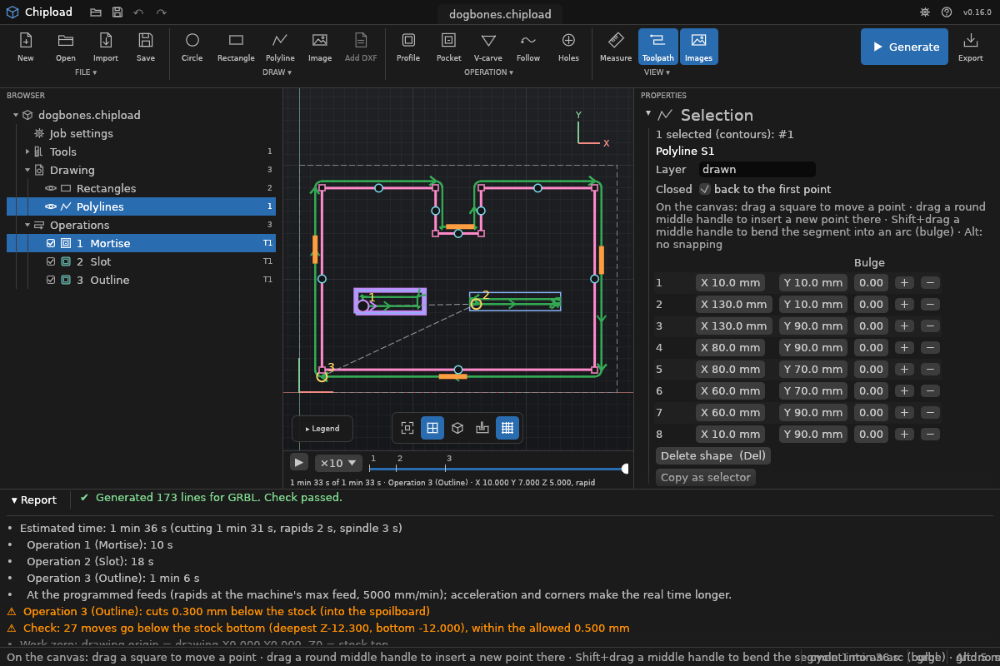

# The window

## The header

At the top, a slim **top bar**:
- **Left:** Open, Save, Undo and Redo.
- **Middle:** the project's name on a tab. A dot on it means unsaved changes.
- **Right:** **⚙ Settings** (tool library, machines, setup sheet, colour theme), **?
  Help** (user guide, keyboard shortcuts, about) and the version.

Under it, the **ribbon** groups the buttons:

| Group | Buttons | Its caption's menu also has |
|---|---|---|
| FILE | New, Open, Import (a DXF as a new project), Save | open recent, save as, update drawing, export, the *…from path* items, undo, redo, quit |
| DRAW | Circle, Rectangle, Polyline, Image, Add DXF | copy, paste, mirror and delete drawn shapes; copy as selector |
| OPERATION | Profile, Pocket, V-carve, Follow, Holes (for the selected shapes) | Generate |
| VIEW | Measure, Toolpath and Images (shown or not) | fit, top and 3D view, Z scale, grid, legend, simulation, update automatically |

**Generate** (F5) and **Export** sit at the right end.

Each group's caption (**FILE ▾** …) opens its whole menu. This guide writes those menus as
*File > …*, *Draw > …* and *View > …*. *Settings > …* and *Help > …* are the gear and the
question mark in the top bar.

The **status bar** at the bottom gives hints on the left. On the right it shows the
cursor's position, the number of copies, the cycle time once generated, the
post-processor and the units.

## The Browser

The **Browser** on the left holds the whole project as a tree:

- **The project**, named after its file.
  - **Job settings:** stock, machine, post-processor and tools, shown on the right when
    clicked. A red dot means one of them has a problem.
  - **Tools:** the project's tools. They are edited in the job settings.
  - **Drawing:** what the shapes come from. Each DXF has its layers under it; then come
    each picture, and the shapes drawn in Chipload by kind (circles, rectangles,
    polylines). See [Several drawings](drawings/several.md).
  - **Operations**, in cutting order. A line marks each tool change.

**Rows:**
- **Click** a row to select it.
  - A DXF, picture or layer selects its shapes for a new operation, and Ctrl+click adds
    to the selection.
  - An operation's row, or *Job settings*, shows its settings on the right.
- **Double-click** a DXF to place it, or a picture to edit it.
- **Right-click** a row for the rest:
  - **A DXF:** *Place…*, *Update from a DXF…* and *Remove*.
  - **A picture:** *Edit…* and *Remove*.
  - **An operation:** *Move up* and *Move down* (also Alt+↑ and Alt+↓), *Duplicate*, *Add
    rest pocket* and *Delete*.
  - **The Drawing folder:** *Add DXF…* and *Import image…*.
  - **The Operations folder:** a new operation for the selected shapes.
- **The triangle** opens and closes a folder, and so does a click on a plain folder like
  *Tools*.

**The eye** hides a DXF, layer, picture or kind of drawn shape on the canvas: it isn't
drawn and can't be clicked. **Hidden shapes are still cut.**

**The tick** in front of an operation turns it on or off. An operation that is off isn't
in the program, and its row is dimmed.

**On an operation's row:**
- **Right end:** its tool, and how many hidden contours it cuts ("3 hidden · T1").
- **A red dot** marks a problem.
- **Hover** the row for its kind, its geometry, its depths, its time once generated and
  its first problem.
- **Drag** the row onto another to move it there.

## The canvas

The canvas shows the stock, the drawing and the toolpath on a soft gradient. It follows the
colour theme: dark, or light grey.

- **The grid** lies on the stock top, in top view and in 3D.
  - Its fine lines are where clicks snap while drawing. A stronger line comes every ten.
  - It follows the zoom, and the status bar gives its step ("grid 5 mm").
  - **G** or *View > Show grid* hides it, and Chipload remembers that.
- **The axes:** a red line along X and a green one along Y run through the program's zero.
  Short thick strokes point the positive way, and in 3D a blue one points up Z.
- **The navigation bar** floats at the bottom: **Fit** (F), **Top** (T), **3D**,
  **Simulation** and **Grid**.
- **The corner:**
  - In 3D, the top right corner has a cube that turns with the view. Click a face (TOP,
    FRONT, RIGHT, BACK, LEFT) to look straight at it.
  - In top view, the corner has an X–Y sign instead.
- **The legend** (bottom left) explains the colours.

## Properties

The **Properties** panel on the right shows what is open: the job settings, or an
operation's settings under its kind and number ("Pocket · Operation 1").

While shapes are selected, a **Selection** section comes first. It holds:
- what is selected, by contour number;
- a drawn shape's exact values, to edit;
- *Copy as selector*, which copies the selection as JSON for a project file.

Its triangle folds it away, so the operation's settings come up.

